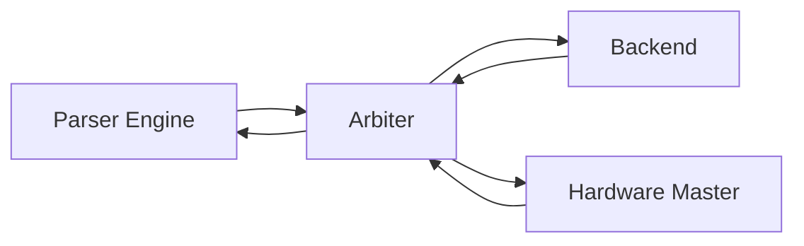

# DexterLab Arbiter Specification

(Version 2026 — Multi-Source Command Arbitration)

The DexterLab Arbiter (`arbiter_mux`) is responsible for selecting which command source is allowed to access the backend execution layer.

The arbiter provides deterministic ownership management, command routing, response routing, and locked-sequence protection for all command producers in the DexterLab ecosystem.

The current implementation supports two command sources:

- Parser Engine
- Hardware Command Master

and operates through the unified DexterLab command interfaces:

```text
t_cmd_out
t_rsp_out
t_rsp_in
```

---

# 1. Overview

The arbiter sits between command generators and backend executors.

```text
Parser
     |
     |
Master
     |
     v
  Arbiter
     |
     v
  Backend
     |
     v
     Bus
```

The arbiter is responsible for:

- Source selection
- Command forwarding
- Response routing
- Ownership management
- Pending command tracking
- Locked sequence handling

The backend remains completely unaware of the command origin.

---

# 2. Architecture



---

# 3. Interfaces

The arbiter communicates through three standard DexterLab interfaces.

---

# 3.1 Parser Side

| Signal | Direction | Description |
|----------|----------|----------|
| parser_valid | in | Parser command valid |
| parser_ready | out | Arbiter ready |
| parser_cmd | in | `t_cmd_out` |
| parser_rsp_in | in | `t_rsp_out` |
| parser_rsp_out | out | `t_rsp_in` |

---

# 3.2 Master Side

| Signal | Direction | Description |
|----------|----------|----------|
| master_valid | in | Master command valid |
| master_ready | out | Arbiter ready |
| master_cmd | in | `t_cmd_out` |
| master_rsp_in | in | `t_rsp_out` |
| master_rsp_out | out | `t_rsp_in` |

---

# 3.3 Backend Side

| Signal | Direction | Description |
|----------|----------|----------|
| valid | out | Command valid |
| ready | in | Backend ready |
| cmd | out | `t_cmd_out` |
| rsp_out | out | `t_rsp_out` |
| rsp_in | in | `t_rsp_in` |

---

# 4. FSM Architecture

The arbiter uses a synchronous FSM.

```vhdl
type t_state is (
    IDLE,
    PARSER_ACTIVE,
    MASTER_ACTIVE
);
```

Current state is stored in:

```vhdl
state_current
```

Next state is determined by:

```vhdl
state_next
```

---

# 5. IDLE State

No source currently owns the backend.

Selection rules:

```text
Parser has priority if
parser_valid = 1

otherwise

Master is selected if
master_valid = 1
```

Result:

```text
IDLE
    |
    +--> PARSER_ACTIVE
    |
    +--> MASTER_ACTIVE
```

---

# 6. PARSER_ACTIVE State

The parser currently owns backend access.

The state is maintained while:

- parser command is pending
- parser holds a lock (`cmd_lock`)
- parser continues issuing commands

Ownership may transfer to the master only when ownership conditions allow it.

---

# 7. MASTER_ACTIVE State

Identical behavior applied to the hardware master.

The master retains ownership while:

- commands remain pending
- lock is active
- additional commands are available

---

# 8. Pending Command Tracking

The arbiter stores accepted commands internally.

Internal signals:

```vhdl
s_parser_pending
s_master_pending
```

A command becomes pending after:

```text
valid = 1
ready = 1
```

The command and response-control records are copied into internal registers.

---

# 9. Pending Command Release

Pending ownership is released when:

```vhdl
rsp_in.rsp_end_cmd = '1'
```

At that point:

```text
Command completed
Resources released
Ownership may change
```

This behaviour follows the common DexterLab execution model:

```text
Phase 1
--------
Command execution

Phase 2
--------
Response publication

Phase 3
--------
Command complete
```

---

# 10. Command Routing

The arbiter routes commands according to:

- current state
- next state
- pending status
- valid status

Routing sources include:

```text
parser_cmd
master_cmd
s_parser_cmd
s_master_cmd
```

depending on ownership and pending state.

---

# 11. Response Routing

Backend responses are routed according to ownership.

Implementation:

```vhdl
parser_rsp_out <= rsp_in
    when state_next = PARSER_ACTIVE
    else s_rsp_out_clear;

master_rsp_out <= rsp_in
    when state_next = MASTER_ACTIVE
    else s_rsp_out_clear;
```

Response delivery is therefore based on:

```text
state_next
```

rather than on command origin history.

---

# 12. Ready Signal Logic

Ready generation depends on:

- backend readiness
- ownership state
- pending status

Outputs:

```text
parser_ready
master_ready
```

are generated from:

```vhdl
s_parser_ready
s_master_ready
```

---

# 13. Locked Sequences

DexterLab supports ownership locking through:

```text
cmd_lock
```

When enabled:

```text
cmd_lock = 1
```

the arbiter retains ownership for the active source.

The competing source cannot obtain access until ownership is released.

This mechanism protects multi-command critical sequences.

---

# 14. Response Handling

The arbiter forwards all backend responses, including:

```text
rsp_valid
rsp_last
rsp_data

rsp_err_valid
rsp_err_code
rsp_err_addr
rsp_err_beat
rsp_err_id

rsp_end_cmd
```

No protocol-specific interpretation is performed.

The arbiter only routes responses.

---

# 15. Implementation Characteristics

The current arbiter implementation consists of:

- Synchronous FSM
- Registered pending-command storage
- Combinational routing logic
- Deterministic ownership rules

It is not a fully asynchronous design.

The implementation uses:

```vhdl
process(clk, resetn)
```

for:

- FSM state storage
- parser pending storage
- master pending storage

---

# 16. Backend Independence

The arbiter does not know whether the selected backend is:

- AXI-FULL
- AXI-LITE
- AHB-FULL
- AHB-LITE
- Generic Backend

All backend interactions occur exclusively through:

```text
t_cmd_out
t_rsp_out
t_rsp_in
```

---

# 17. Summary

The DexterLab Arbiter:

- Selects between parser and hardware master
- Tracks command ownership
- Stores pending commands
- Routes responses deterministically
- Supports locked command sequences through `cmd_lock`
- Implements a synchronous FSM architecture
- Remains completely backend-independent
- Forms the central connection between command producers and backend executors

It is the core arbitration layer of the DexterLab command execution architecture.

---

# End of Document
