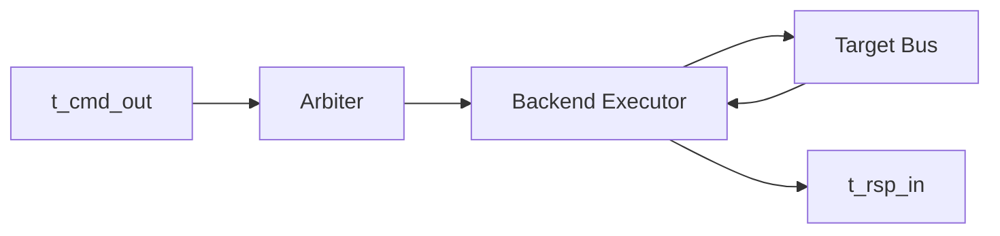

# DexterLab Backend Overview

The DexterLab backend layer is responsible for converting high-level parser commands (`t_cmd_out`) into protocol-specific bus transactions and translating bus responses back into parser responses (`t_rsp_in`).

Each backend implements a specific bus protocol while preserving the unified DexterLab command interface.

Supported backend families include:

- Generic
- AXI-FULL
- AXI-LITE
- AHB-FULL
- AHB-LITE
- TileLink

Backends are the final stage of the command execution pipeline:

```text
Parser
   |
Arbiter
   |
Backend
   |
Bus
```

This document provides an overview of all backend types, their responsibilities, and their integration within the DexterLab architecture.

---

# 1. Backend Responsibilities

Every backend must:

- Accept commands via `t_cmd_out`
- Execute those commands according to the target bus protocol
- Generate responses via `t_rsp_in`
- Implement the subset of parser features supported by the target protocol
- Enforce protocol-specific rules
- Detect timeout conditions
- Propagate protocol and execution errors
- Integrate seamlessly with the arbiter
- Preserve command ordering

Backends are protocol-specific but parser-independent.

The parser remains completely unaware of the selected bus protocol.

---

# 2. Common Backend Architecture

All current backends implement the same execution model.

```text
Phase 1
--------
Command execution

Phase 2
--------
Response publication

Phase 3
--------
Parser ready
```

This architecture guarantees:

- Deterministic command completion
- Consistent error reporting
- Uniform response generation
- Backend-independent parser behavior

The model is shared by:

- AXI-FULL
- AXI-LITE
- AHB-FULL
- AHB-LITE

---

# 3. Backend Families

DexterLab supports multiple backend implementations.

---

## 3.1 Generic Backend (`backend_generic`)

A lightweight protocol-independent backend used primarily for simulation and parser validation.

### Features

- Pure VHDL implementation
- No external bus protocol
- AXI-like command semantics
- WSTRB support
- FIFO support
- BURST support
- WRAP support
- 4KB boundary validation
- RAM, FIFO and register models

### Typical Use Cases

- Fast simulation
- Continuous Integration (CI)
- Parser development
- Backend prototyping
- Functional verification

---

## 3.2 AXI-FULL Backend (`backend_axi_full`)

The most complete backend currently available.

### Features

- AXI4-compliant transaction model
- Independent AW/W/B channels
- Independent AR/R channels
- Multi-beat bursts
- WRAP bursts
- WSTRB masking
- Burst lengths up to 256 beats
- Protocol validation
- Timeout detection
- Full error reporting

### Optional AXI Signals

- AWLOCK
- AWREGION
- AWQOS
- ARLOCK
- ARREGION
- ARQOS

### Typical Use Cases

- High-performance SoCs
- FPGA IP integration
- DMA engines
- Memory subsystems
- Vendor IP simulation

---

## 3.3 AXI-LITE Backend (`backend_axi_lite`)

A lightweight AXI implementation optimized for register-oriented access.

### Features

- Single-beat transactions
- WSTRB support
- Timeout detection
- Simplified response model
- AXI-LITE compliance

### Limitations

- No bursts
- No wrap transactions
- No multi-beat operations

### Typical Use Cases

- MMIO registers
- Configuration interfaces
- Status registers
- Low-bandwidth peripherals

---

## 3.4 AHB-FULL Backend (`backend_ahb_full`)

A complete AHB implementation supporting burst-oriented operation.

### Features

- HBURST support
- HTRANS sequencing
- Multi-beat transfers
- WRAP bursts
- FIFO support
- Timeout detection
- Wait-state handling
- Detailed error reporting

### Characteristics

- Deterministic timing
- Burst-aware slave support
- Explicit burst-length signalling

### Typical Use Cases

- Embedded SoCs
- Deterministic interconnects
- Verification environments
- MCU subsystems

---

## 3.5 AHB-LITE Backend (`backend_ahb_lite`)

A simplified AHB implementation that preserves the complete parser transaction model.

### Features

- Multi-beat transfers
- Internal burst sequencing
- Internal wrap-address generation
- Wait-state support
- Timeout detection
- Error reporting

### Characteristics

- No HBURST signal
- No RETRY responses
- No SPLIT responses
- Burst execution managed internally by the backend

The backend generates:

```text
NONSEQ
SEQ
SEQ
SEQ
...
```

sequences and computes burst addresses without relying on HBURST signalling.

### Typical Use Cases

- Lightweight embedded systems
- MCU-class designs
- Verification environments
- Simple memory-mapped systems

---

## 3.6 TileLink Bridge (`tilelink_bridge`)

The TileLink bridge converts TileLink transactions into the DexterLab parser command model.

### Supported TileLink Operations

- Get → READ
- PutFullData → WRITE
- PutPartialData → Masked WRITE
- ArithmeticData → Atomic command
- LogicalData → Atomic command
- TileLink-UH bursts

### Typical Use Cases

- RISC-V SoCs
- TileLink-based systems
- Research platforms
- Hybrid bus environments

---

# 4. Backend Selection

Backend selection is performed statically.

Available implementations include:

```text
backend_generic
backend_axi_full
backend_axi_lite
backend_ahb_full
backend_ahb_lite
tilelink_bridge
```

The parser and arbiter remain unchanged regardless of the selected backend.

All supported backends implement:

```text
t_cmd_out
    |
Backend
    |
t_rsp_in
```

---

# 5. Backend Integration



The bus protocol changes, while the parser interface remains constant.

---

# 6. Adding a Custom Backend

DexterLab allows users to implement custom backend implementations.

Required steps:

1. Implement `t_cmd_out` to protocol conversion
2. Implement protocol response to `t_rsp_in` conversion
3. Implement command execution sequencing
4. Implement error handling
5. Implement timeout handling
6. Integrate with the arbiter
7. Provide a verification testbench

Possible custom backends include:

- Wishbone
- APB
- Avalon
- Proprietary buses
- Streaming engines
- Accelerator interfaces

---

# 7. Backend Comparison

| Backend | BURST | WRAP | FIFO | WSTRB | Multi-ID | Typical Use |
|----------|--------|--------|--------|--------|-----------|--------------|
| Generic | ✔ | ✔ | ✔ | ✔ | ✘ | Simulation |
| AXI-FULL | ✔ | ✔ | ✔ | ✔ | ✔ | High-performance systems |
| AXI-LITE | ✘ | ✘ | ✘ | ✔ | ✘ | MMIO |
| AHB-FULL | ✔ | ✔ | ✔ | ✘ | ✘ | Deterministic systems |
| AHB-LITE | ✔ | ✔ | ✔ | ✘ | ✘ | Embedded systems |
| TileLink Bridge | ✔ | ✔ | ✘ | ✔ | ✔ | RISC-V systems |

### Notes

For AHB-LITE:

- Burst execution is supported.
- Wrap execution is supported.
- Burst metadata is not exposed on the bus.
- Address generation is handled internally by the backend.

---

# 8. Summary

DexterLab backends:

- Convert parser commands into bus transactions
- Preserve a common parser interface
- Share a common response architecture
- Support AXI, AHB, TileLink and Generic execution models
- Handle protocol-specific validation
- Detect and report errors
- Support timeout management
- Integrate directly with the arbiter
- Require no wrapper layer

Backends are the foundation that allows DexterLab to operate across heterogeneous hardware systems while preserving a unified command and response model.

---

# End of Document
