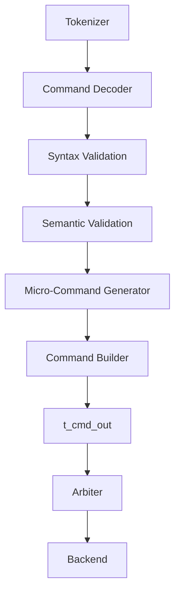

# DexterLab Parser Engine Internals

(Version 2026 — Tokenizer, Decoder, Validator, Micro-Command Generator)

The DexterLab Parser Engine converts textual command files into structured command transactions that can be executed by the DexterLab backend infrastructure.

The parser is protocol-independent and operates identically regardless of whether commands are executed by:

- Generic Backend
- AXI-FULL
- AXI-LITE
- AHB-FULL
- AHB-LITE

The parser does not generate bus transactions directly.

Its purpose is to:

- Parse command files
- Validate commands
- Expand high-level operations
- Generate executable micro-commands
- Build protocol-independent command records
- Forward commands to the arbiter/backend infrastructure

---

# 1. High-Level Architecture

The parser processes commands through multiple stages.



Each stage performs a specific transformation while preserving deterministic behavior.

---

# 2. Internal Command Model

The parser uses two internal command representations.

## Logical Command (`t_cmd`)

Represents a parsed command before expansion.

Contains:

- Command type
- Address information
- Length information
- Data payload
- Variable references
- File references
- Timeout settings
- Atomic state
- Error injection information

This structure represents the user's command as written.

---

## Micro-Command (`t_mc_cmd`)

Represents an executable parser operation.

Contains:

- Command type
- Command ID
- Address
- Data
- Length
- Timeout information
- Atomic state
- Byte-enable information
- Error injection information

Large logical commands may generate multiple micro-commands.

---

# 3. Tokenizer

The tokenizer converts text into parser tokens.

Responsibilities:

- Remove comments
- Normalize whitespace
- Separate operators
- Detect identifiers
- Detect numbers
- Detect strings
- Detect command names

Supported token types:

```text
TK_START
TK_COMMAND
TK_IDENTIFIER
TK_NUMBER
TK_OPERATOR
TK_STRING
TK_FILENAME
TK_END
```

---

## Example

Input:

```text
WRITE BASE_RAM + 0x100 0x12345678
```

Token stream:

```text
WRITE
BASE_RAM
+
0x100
0x12345678
```

---

# 4. Command Decoder

The decoder converts textual command names into:

```text
t_command
```

values.

Example:

```text
WRITE
```

becomes:

```text
CMD_WRITE
```

The decoder is case-insensitive.

Unknown commands become:

```text
CMD_UNKNOWN
```

which immediately generate parser errors.

---

# 5. Supported Command Set

The parser currently recognizes:

```text
CMD_SET_VAR
CMD_INCLUDE
CMD_PRINT
CMD_END_SIM

CMD_SET_ATOMIC

CMD_WAIT_TIME
CMD_WAIT_CLOCKS
CMD_WAIT_SIM_TIME

CMD_WSTRB_WRITE

CMD_WRITE
CMD_READ
CMD_CHECK

CMD_FIFO_WRITE
CMD_FIFO_READ
CMD_FIFO_CHECK

CMD_BURST_WRITE
CMD_BURST_READ
CMD_BURST_CHECK

CMD_WRAP_WRITE
CMD_WRAP_READ
CMD_WRAP_CHECK

CMD_FILL_LEN
CMD_FILL_RANGE
CMD_FILL_CHECK

CMD_POLL_READ
CMD_POLL_TOGGLE

CMD_TEST_ERROR

CMD_DUMP_LEN
CMD_DUMP_RANGE
CMD_DUMP_FILE_LEN
CMD_DUMP_FILE_RANGE
CMD_DUMP_FILE_CHECK_LEN
CMD_DUMP_FILE_CHECK_RANGE

CMD_STOP
CMD_END_SIM
```

See:

```text
command_set.md
```

for detailed command descriptions.

---

# 6. Syntax Validation

The parser validates command syntax using:

```text
CMD_SIG
```

which defines:

- Minimum parameter count
- Maximum parameter count
- Expected parameter types
- Alignment requirements
- Burst capability
- Wrap capability

Examples:

```text
WRITE <addr> <data>
```

```text
READ <addr>
```

```text
BURST_WRITE <len> <addr>
```

Any mismatch generates a parser error before command execution.

---

# 7. Semantic Validation

After syntax validation the parser verifies semantic correctness.

Checks include:

---

## Address Validation

- Address format
- Address alignment
- Address expression evaluation

---

## Length Validation

- Length > 0
- Length within supported limits

---

## Burst Validation

- Supported burst sizes
- Boundary compliance

---

## Wrap Validation

- Power-of-two wrap sizes
- Valid wrap configuration

---

## FIFO Validation

- FIFO command compatibility
- Parameter consistency

---

## Poll Validation

- Timeout limits
- Delay parameters
- Mask configuration

---

# 8. Variable Engine

Variables are created using:

```text
SET_VAR
```

Example:

```text
SET_VAR BASE_RAM 0x1000
```

and can later be used inside expressions.

Example:

```text
WRITE BASE_RAM + 0x20 0xDEADBEEF
```

Supported operations include:

```text
+
-
```

Variables are inherited through include chains.

---

# 9. Include Engine

The parser supports nested command files.

Example:

```text
INCLUDE memory_init.cmd
```

Capabilities:

- Nested includes
- Variable inheritance
- Include stack tracking
- Error propagation

Include recursion is limited by:

```text
C_MAX_INCLUDE_DEPTH
```

Current default:

```text
16
```

---

# 10. Micro-Command Generator

High-level commands are transformed into executable micro-commands.

Examples include:

```text
BURST commands
WRAP commands
FILL operations
DUMP operations
POLL operations
```

The generator creates one or more:

```text
t_mc_cmd
```

entries.

The generated commands are stored in:

```text
t_mc_list
```

for execution.

---

# 11. Command Builder

The command builder converts micro-commands into:

```text
t_cmd_out
```

records.

Generated fields include:

```text
cmd_write
cmd_burst
cmd_wrap
cmd_fifo

cmd_id
cmd_addr
cmd_len

cmd_data
cmd_wstrb

cmd_prot
cmd_size
cmd_lock
cmd_cache
cmd_qos

cmd_err_code
```

These records form the protocol-independent command interface used by all backends.

---

# 12. Burst Processing

The parser supports logical burst commands larger than backend limits.

Example:

```text
BURST_WRITE 1024 0x1000
```

Large operations may be internally split into multiple micro-commands.

The splitting mechanism ensures:

- Backend compatibility
- Boundary compliance
- Deterministic execution

---

# 13. Wrap Processing

Wrap commands define wrapping address behavior.

Example:

```text
WRAP_READ 8 0x2000
```

The parser validates:

- Wrap size
- Alignment
- Protocol legality

Address generation itself remains backend-specific.

The parser does not generate protocol-specific wrap addresses.

---

# 14. FIFO Engine

Supported commands:

```text
FIFO_WRITE
FIFO_READ
FIFO_CHECK
```

The FIFO engine performs:

- Parameter validation
- Command expansion
- Length verification
- Consistency checks

Protocol execution remains the responsibility of the backend.

---

# 15. Polling Engine

Supported commands:

```text
POLL_READ
POLL_TOGGLE
```

The polling engine generates repeated command execution until:

- Success condition met
- Maximum attempts reached
- Error detected

Capabilities:

- Delay handling
- Timeout management
- Retry generation

---

# 16. Dump and Check Engine

Supported commands:

```text
DUMP_LEN
DUMP_RANGE

DUMP_FILE_LEN
DUMP_FILE_RANGE

DUMP_FILE_CHECK_LEN
DUMP_FILE_CHECK_RANGE
```

Responsibilities:

- Memory extraction
- File generation
- File comparison
- Verification support

These operations simplify simulation debugging and regression testing.

---

# 17. Atomic Control

Atomic execution is controlled through:

```text
SET_ATOMIC
```

When enabled, generated commands are marked for locked execution.

The command builder propagates:

```text
cmd_lock
```

into generated command records.

Ownership protection is enforced by the arbiter.

---

# 18. Error Injection Support

The parser supports:

```text
TEST_ERROR
```

which generates commands containing:

```text
cmd_err_code
```

This mechanism is primarily used for:

- Backend verification
- Error-path testing
- Regression testing

---

# 19. Output Generation

The parser ultimately produces:

```text
t_cmd_out
```

transactions.

Output flow:

```text
Command File
      |
Tokenizer
      |
Decoder
      |
Validation
      |
Micro-Command Generation
      |
Command Builder
      |
t_cmd_out
      |
Arbiter
      |
Backend
```

The parser never interacts directly with bus signals.

---

# 20. Summary

The DexterLab Parser Engine:

- Tokenizes command files
- Decodes commands
- Validates syntax
- Validates semantics
- Expands logical commands
- Generates micro-commands
- Handles variables
- Handles include files
- Handles polling operations
- Handles dump operations
- Supports error injection
- Supports atomic execution
- Generates protocol-independent `t_cmd_out` transactions

It is the core translation layer that connects user-readable command scripts to the DexterLab backend execution infrastructure.

---

# End of Document
