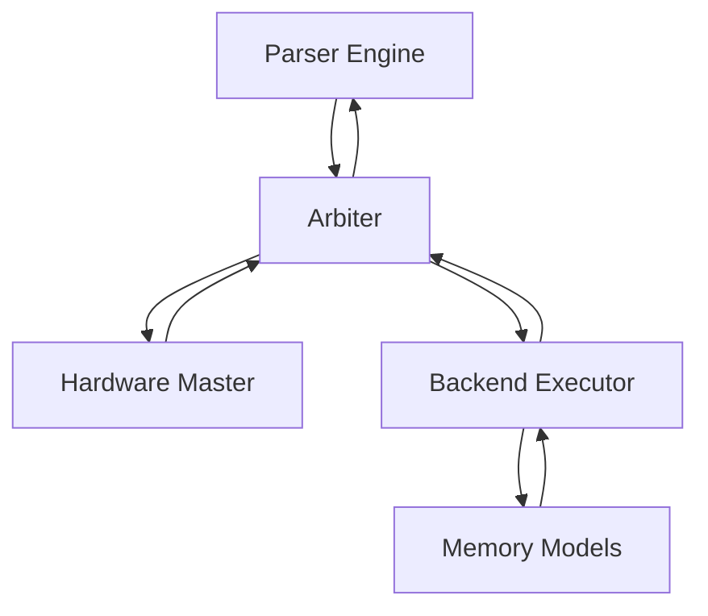
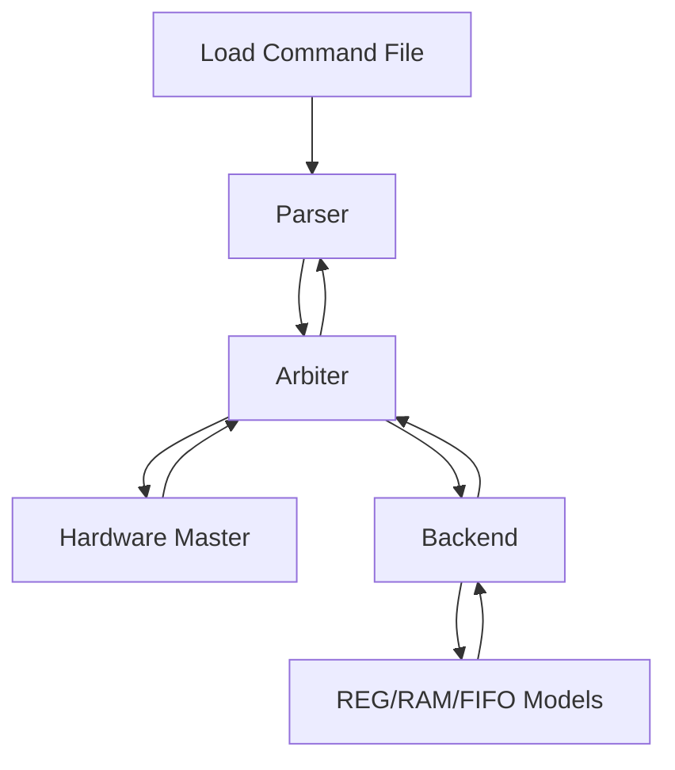

# DexterLab Testbench Architecture

(Version 2026 — Parser, Arbiter, Backend, Memory Models, Master)

The DexterLab Testbench provides a complete simulation environment for validating the entire DexterLab command execution architecture.

The testbench supports:

- Command-file execution
- Backend validation
- Arbitration verification
- Memory model verification
- Error injection testing
- Hardware master integration
- TileLink integration

The architecture is modular, deterministic, protocol-independent, and portable across IEEE-compliant VHDL simulators.

---

# 1. High-Level Architecture

The testbench simulates the complete DexterLab execution pipeline.



Execution flow:

```text
Parser / Master
       |
       v
    Arbiter
       |
       v
    Backend
       |
       v
 Memory Models
       |
       v
    Backend
       |
       v
    Arbiter
       |
       v
Parser / Master
```

This architecture mirrors the execution model used throughout the DexterLab ecosystem.

---

# 2. Testbench Components

The standard testbench contains the following components.

| Component | Purpose |
|------------|----------|
| Parser Engine | Executes `.cmd` files |
| Hardware Master | Secondary hardware command source |
| Arbiter | Selects active command source |
| Backend Executor | Executes commands |
| REG Model | Register region simulation |
| RAM Model | Memory simulation |
| FIFO Model | FIFO endpoint simulation |
| Clock Generator | System clock |
| Reset Generator | System reset |
| Waveform Support | Simulator waveform generation |
| Test Sequencer | Regression execution |

All components are implemented in portable VHDL.

---

# 3. Parser Integration

The parser is responsible for:

- Loading command files
- Tokenizing input
- Decoding commands
- Validating syntax
- Validating semantics
- Expanding logical commands
- Generating micro-commands
- Validating wrap configuration
- Building `t_cmd_out`
- Consuming `t_rsp_in`

The parser provides:

```text
t_cmd_out
t_rsp_out
```

and receives:

```text
t_rsp_in
```

The parser does not generate bus transactions directly.

All protocol execution is delegated to the backend layer.

---

# 4. Hardware Master Integration

The testbench may instantiate:

```text
cmd_master
```

which acts as a hardware-originated command source.

Current placeholder behavior:

```text
cmd_write = 0
cmd_burst = 0
cmd_wrap  = 0
cmd_fifo  = 0

cmd_len   = 1

cmd_addr  = 0x00000000
```

Result:

```text
Continuous READ transactions
```

The placeholder implementation is used to validate:

- Arbiter ownership
- Backend routing
- Response routing
- Multi-source execution

Future versions may be replaced by:

- RISC-V processors
- DMA engines
- FPGA accelerators
- Embedded controllers

---

# 5. Arbiter Integration

The arbiter manages backend ownership.

Responsibilities include:

- Source selection
- Pending command tracking
- Response routing
- Ownership retention
- Locked execution support

The arbiter receives:

```text
Parser
Master
```

and forwards commands to:

```text
Backend Executor
```

Locked execution is supported through:

```text
cmd_lock
```

which prevents ownership changes during protected command sequences.

---

# 6. Backend Integration

The testbench supports execution using any DexterLab backend.

Supported backends:

```text
backend_generic
backend_axi_full
backend_axi_lite
backend_ahb_full
backend_ahb_lite
```

Each backend receives:

```text
t_cmd_out
t_rsp_out
```

and generates:

```text
t_rsp_in
```

Backend selection is independent of parser behavior.

---

# 7. Memory Models

Memory models provide simulation targets for backend accesses.

---

# 7.1 REG Model

Address range:

```text
0x0000 – 0x001F
```

Contents:

```text
REG0
REG1
REG2
REG3
REG4
REG5
REG6
REG7
```

Characteristics:

- Single-beat accesses
- Control/status semantics
- Deterministic behavior

---

# 7.2 RAM Model

Address range:

```text
0x1000 – 0x2FFF
```

Capabilities:

- Read operations
- Write operations
- WSTRB support
- Burst operations
- Wrap operations
- Fill operations
- Dump operations
- Poll operations

The RAM model acts as the primary validation target for backend testing.

---

# 7.3 FIFO Model

Endpoints:

```text
0x3000 -> FIFO_WRITE
0x3100 -> FIFO_READ
```

Capabilities:

- Push operations
- Pop operations
- FIFO checking
- Underflow detection
- Overflow detection

---

# 8. Clock and Reset

The testbench provides standard system timing.

Example:

```vhdl
clk <= not clk after 5 ns;

resetn <= '0',
          '1' after 20 ns;
```

Used by:

- Parser
- Arbiter
- Backends
- Memory models

---

# 9. Common Execution Model

The testbench follows the standard DexterLab execution flow.

```text
Phase 1
--------
Command execution

Phase 2
--------
Response publication

Phase 3
--------
Command completion
```

Command completion is indicated through:

```text
rsp_end_cmd
```

This model is shared by all supported backends.

---

# 10. Waveform Support

Supported waveform outputs include:

```text
VCD
FST
WLF
XSIM
```

Examples:

### GHDL

```bash
ghdl -r tb --wave=tb.fst
```

### Questa / ModelSim

```text
wave.do
```

### Vivado

```text
xsim waveform database
```

Waveforms simplify:

- Debugging
- Protocol analysis
- Regression diagnosis

---

# 11. Test Sequencer

The testbench can execute multiple command files.

Example sequence:

```text
init.cmd
memory_test.cmd
fifo_test.cmd
burst_test.cmd
wrap_test.cmd
error_test.cmd
```

Typical execution flow:

```text
Load file
Execute commands
Collect responses
Generate report
Load next file
```

---

# 12. DRY_RUN Mode

DRY_RUN allows parser validation without backend execution.

In DRY_RUN mode:

```text
Commands parsed
Commands validated
Commands printed
Commands not executed
```

Typical use cases:

- Syntax validation
- Semantic validation
- CI pipelines
- Documentation examples

Additional details:

```text
cmd_dry_run.md
```

---

# 13. TileLink Bridge Integration

Optional TileLink support may be added through:

```text
tilelink_bridge
```

This allows simulation of:

- TL-UL
- TL-UH
- RISC-V TileLink masters

Execution flow:

```text
TileLink
      |
      v
TileLink Bridge
      |
      v
t_cmd_out
      |
      v
Arbiter
      |
      v
Backend
```

Responses return through:

```text
t_rsp_in
      |
      v
TileLink Bridge
      |
      v
TileLink Response
```

---

# 14. Testbench Flow Summary



---

# 15. Summary

The DexterLab Testbench provides a complete verification environment for the entire command ecosystem.

It supports:

- Parser execution
- Hardware masters
- Arbitration
- Backend validation
- REG/RAM/FIFO simulation
- Error handling verification
- TileLink integration
- Waveform generation
- DRY_RUN execution
- Regression testing

The architecture mirrors the real DexterLab command flow and serves as the primary validation environment for parser, arbiter, backend, and future hardware-master development.

---

# End of Document
