# DexterLab Architecture Diagrams

This document collects the primary architecture and execution-flow diagrams used throughout the DexterLab documentation.

The diagrams reflect the DexterLab v1.1.0 architecture and are intended to complement the detailed functional specifications.

---

# 1. Global Architecture

The entire framework is organized around a protocol-independent command model.

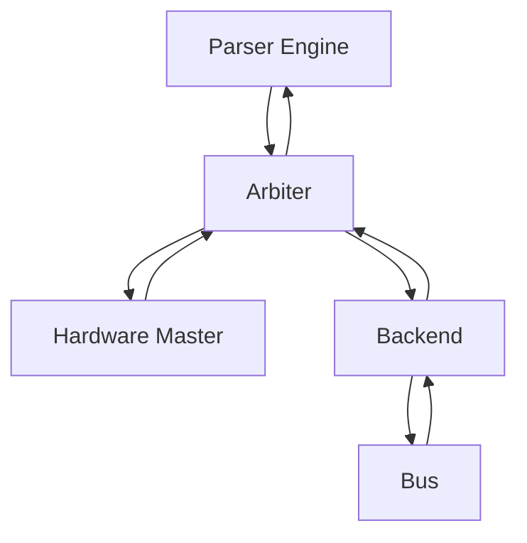

---

# 2. Command Execution Flow

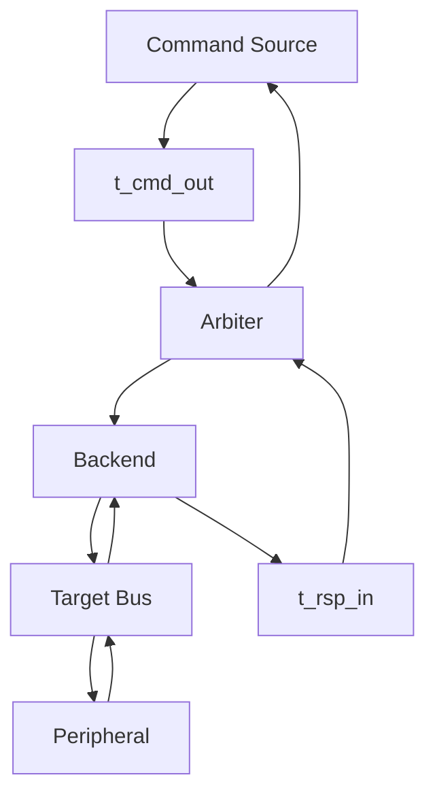

---

# 3. Parser Internal Pipeline

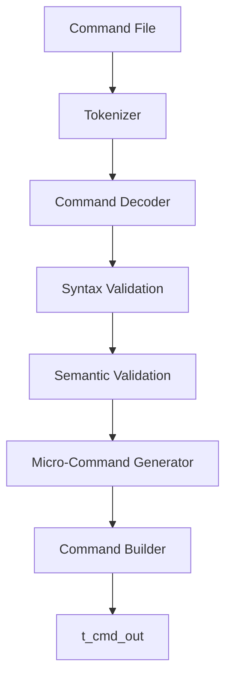

---

# 4. Multi-Source Arbitration

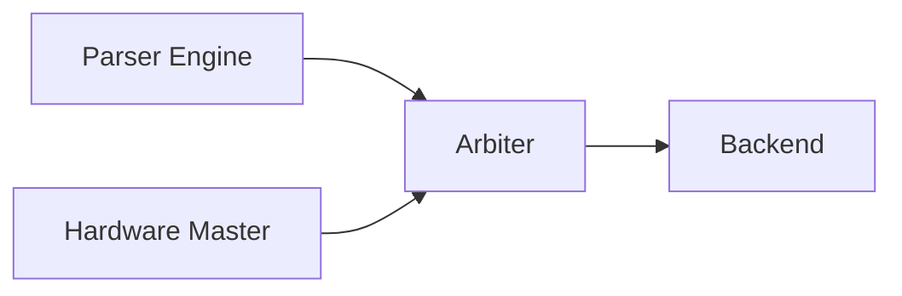

The arbiter manages:

- Ownership
- Pending commands
- Response routing
- Locked command sequences

---

# 5. Backend Selection

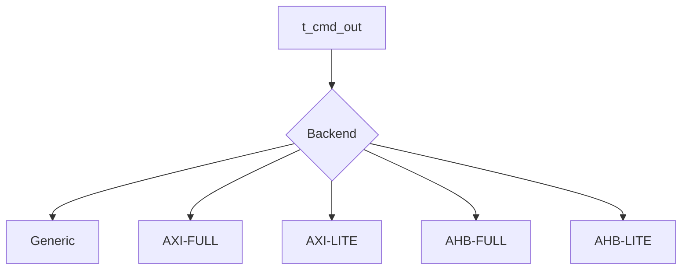

---

# 6. Common Execution Model

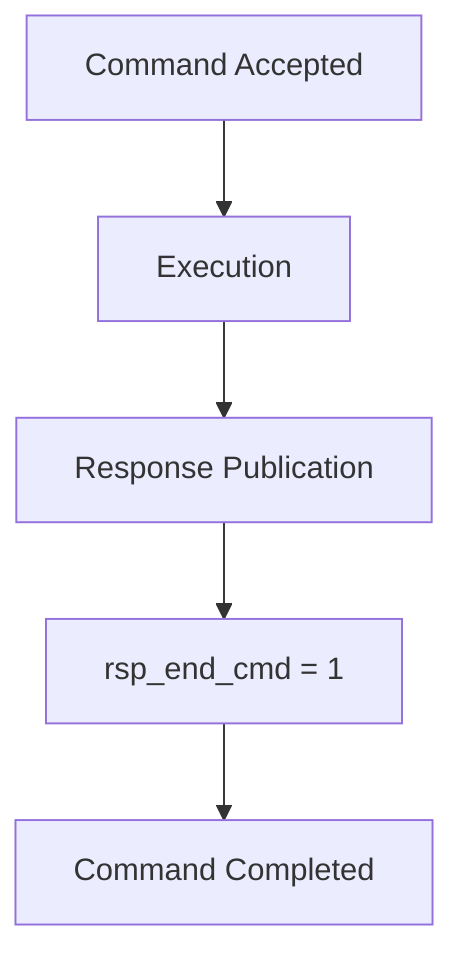

---

# 7. Generic Backend Structure

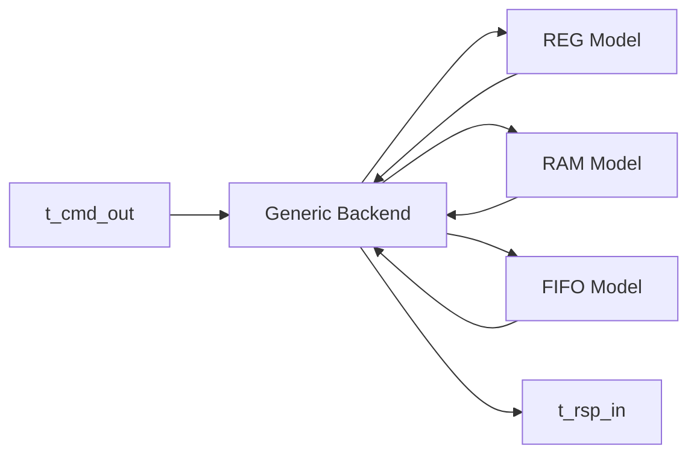

---

# 8. Burst Expansion

Large logical commands may be expanded into multiple micro-commands.

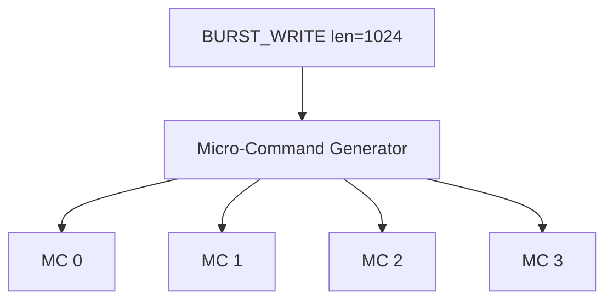

---

# 9. Boundary Validation

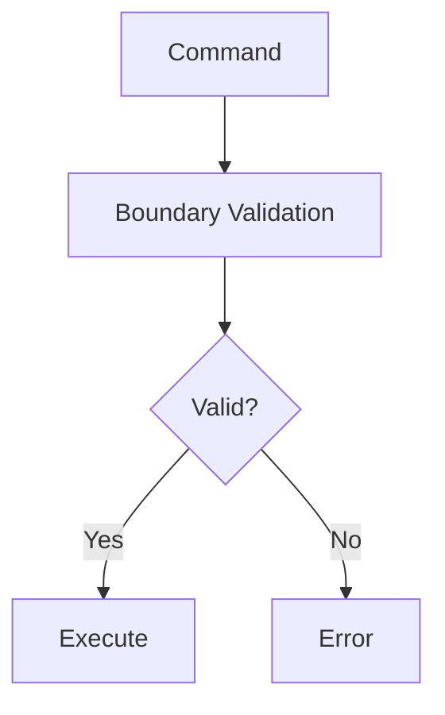

---

# 10. Wrap Command Processing

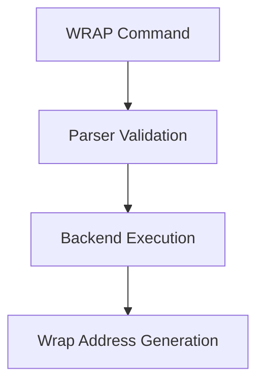

The parser validates wrap legality.

The backend implements wrap addressing.

---

# 11. FIFO Operations

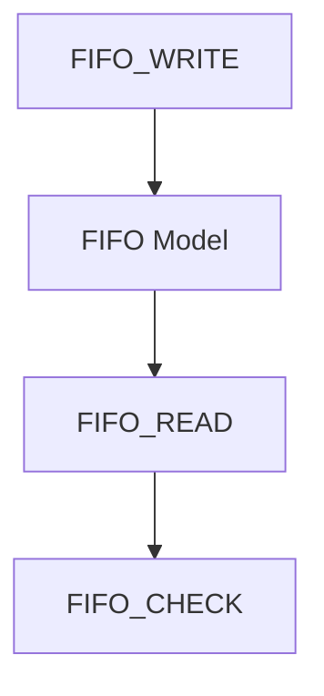

---

# 12. Polling Operations

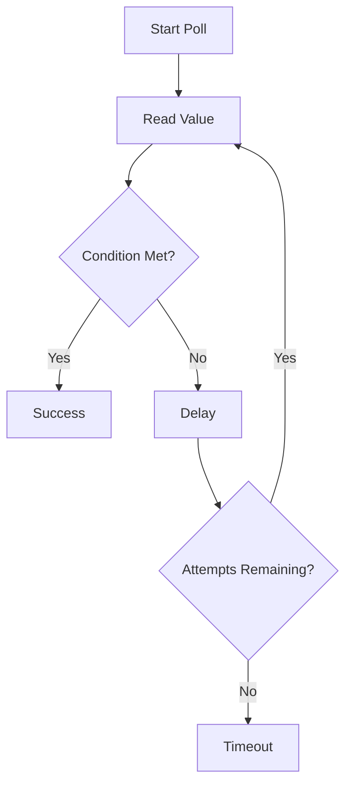

Supported commands:

```text
POLL_READ
POLL_TOGGLE
```

---

# 13. Atomic Command Flow

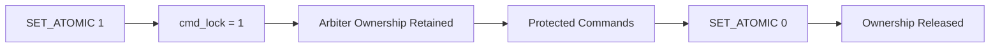

---

# 14. Error Propagation

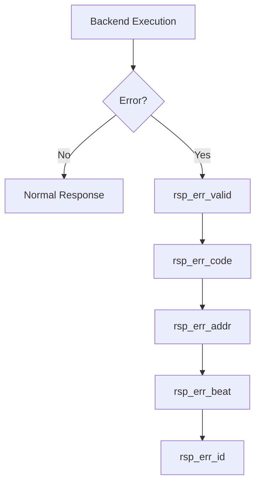

---

# 15. TileLink Integration

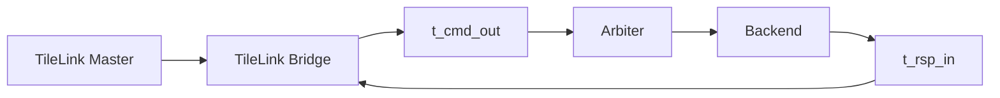

---

# 16. Verification Environment

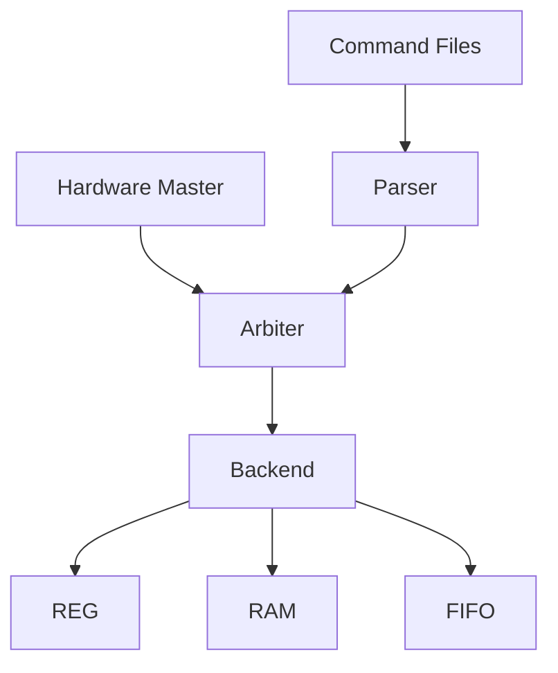

---

# 17. Documentation Relationships

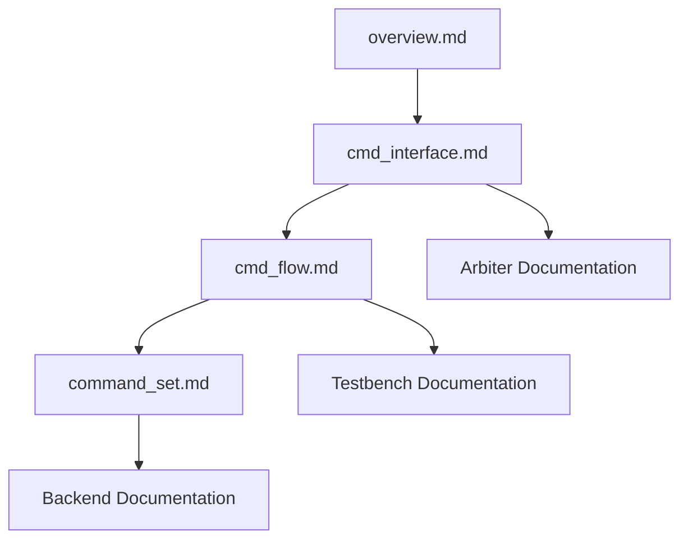

---

# End of Document
