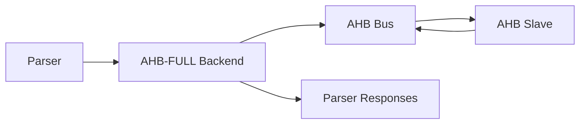

# DexterLab AHB-FULL Backend

The AHB-FULL backend converts high-level parser commands (`t_cmd_out`) into AHB-FULL bus transactions and translates bus responses back into parser responses (`t_rsp_in`).

It implements complete support for:

- SINGLE transfers
- INCR bursts
- WRAP bursts
- FIFO transactions
- Multi-beat operations
- Wait-state handling
- Timeout detection
- Protocol validation
- Error propagation

The backend is intended for simulation and verification environments and serves as the AHB counterpart of the AXI-FULL backend.

---

# 1. Overview

The backend receives commands from the parser/arbiter infrastructure and executes them over an AHB-FULL bus.

Supported command families include:

- WRITE
- READ
- CHECK
- BURST_WRITE
- BURST_READ
- BURST_CHECK
- WRAP_WRITE
- WRAP_READ
- WRAP_CHECK
- FIFO_WRITE
- FIFO_READ
- FIFO_CHECK

The backend is responsible for:

- AHB transaction generation
- Address sequencing
- Burst tracking
- Wrap address generation
- Wait-state management
- Timeout detection
- Bus error reporting

---

# 2. Architecture



The parser generates protocol-independent commands.

The backend translates those commands into AHB-FULL transactions.

---

# 3. AHB-FULL Signals

## Address and Control

- HADDR
- HWRITE
- HSIZE
- HBURST
- HTRANS
- HREADY
- HRESP

## Write Data

- HWDATA

## Read Data

- HRDATA

---

# 4. Command Mapping

| Command Field | AHB Usage |
|---------------|-----------|
| cmd_write | HWRITE |
| cmd_addr | HADDR |
| cmd_size | HSIZE |
| cmd_burst | HBURST generation |
| cmd_wrap | HBURST generation + wrap addressing |
| cmd_len | Burst length |
| cmd_data | HWDATA |
| cmd_id | Response correlation |
| cmd_wstrb | Validation only |

---

# 5. Backend State Machine

The backend uses the following execution FSM:

```text
IDLE

WR_ADDR
WR_DATA
WR_RESP

RD_ADDR
RD_DATA
RD_RESP

ERR_DRAIN
```

State purposes:

| State | Description |
|---------|-------------|
| IDLE | Wait for new command |
| WR_ADDR | Write address phase |
| WR_DATA | Write data phase |
| WR_RESP | Write response phase |
| RD_ADDR | Read address phase |
| RD_DATA | Read data phase |
| RD_RESP | Read response phase |
| ERR_DRAIN | Synthetic execution phase for pre-bus errors |

---

# 6. Internal Response Pipeline

Responses are generated using a three-phase execution model.

```text
Phase 1
--------
Command execution

WR_DATA
RD_DATA
ERR_DRAIN

Phase 2
--------
Response publication

WR_RESP
RD_RESP

Phase 3
--------
Ready for next command

IDLE
```

This architecture guarantees deterministic command completion and error reporting.

---

# 7. HTRANS Sequencing

AHB transfers follow standard sequencing rules.

First beat:

```text
HTRANS = NONSEQ
```

Following beats:

```text
HTRANS = SEQ
```

Example:

```text
Beat 0 -> NONSEQ
Beat 1 -> SEQ
Beat 2 -> SEQ
Beat 3 -> SEQ
```

---

# 8. HBURST Encoding

The backend generates HBURST values automatically.

| Burst Type | HBURST |
|------------|---------|
| SINGLE | 000 |
| INCR | 001 |
| WRAP4 | 010 |
| INCR4 | 011 |
| WRAP8 | 100 |
| INCR8 | 101 |
| WRAP16 | 110 |
| INCR16 | 111 |

HBURST is selected from:

- cmd_burst
- cmd_wrap
- cmd_len

---

# 9. Address Generation

## Incrementing Bursts

```text
addr
addr + size
addr + 2*size
addr + 3*size
...
```

## Wrapping Bursts

The backend computes:

- wrap boundary
- wrap size
- wrapped address

according to AHB burst semantics.

Address generation is performed internally and does not depend on the slave.

---

# 10. Wait-State Handling

The backend fully supports slave-generated wait states.

When:

```text
HREADY = 0
```

the current transfer is held.

The backend keeps:

- HADDR
- HWRITE
- HTRANS
- HSIZE
- HBURST

stable until:

```text
HREADY = 1
```

---

# 11. Timeout Handling

A timeout counter is active only while waiting for bus completion:

```text
WR_ADDR
WR_DATA
RD_ADDR
RD_DATA
```

If the timeout expires:

```text
AHB_FULL TIMEOUT
```

is reported to the parser.

---

# 12. Error Handling

The backend detects and reports:

## Bus Errors

```text
HRESP = ERROR
```

Mapped to:

```text
AHB_FULL ERROR
```

## Timeout

```text
AHB_FULL TIMEOUT
```

## Boundary Violations

```text
AHB_FULL BOUNDARY_ERR
```

## Invalid Bursts

```text
AHB_FULL BURST_ERR
```

## Invalid Write Strobes

```text
AHB_FULL WSTRB_ERR
```

Error information includes:

- error code
- address
- beat index
- command ID

---

# 13. Response Generation

Responses returned to the parser include:

```text
rsp_valid
rsp_last
rsp_data

rsp_err_valid
rsp_err_code
rsp_err_addr
rsp_err_beat

rsp_end_cmd
```

This allows:

- command completion tracking
- detailed logging
- error correlation
- diagnostic reporting

---

# 14. Atomic Mode

Atomic command execution is managed entirely by the arbiter.

The backend executes commands in the order received.

No additional atomic logic is required inside the backend.

---

# 15. Validation Status

Validated through complete regression suites:

- Parser
- Base
- FIFO
- Burst
- Wrap
- Fill
- Poll
- Dump
- AHB error injection

Reference result:

```text
TOTAL EXEC ERRORS = 0
TOTAL ERRORS      = 0
SIMULATION RESULT = OK
```

---

# 16. Summary

The AHB-FULL backend:

- Converts parser commands into AHB-FULL transactions
- Supports SINGLE, BURST, WRAP and FIFO operations
- Generates correct HTRANS and HBURST sequences
- Handles wait states and timeouts
- Detects and reports bus and protocol errors
- Implements a unified three-phase response pipeline
- Returns structured responses through `t_rsp_in`

The module represents the reference AHB-FULL implementation of the DexterLab command-parser ecosystem.

---

# End of Document
