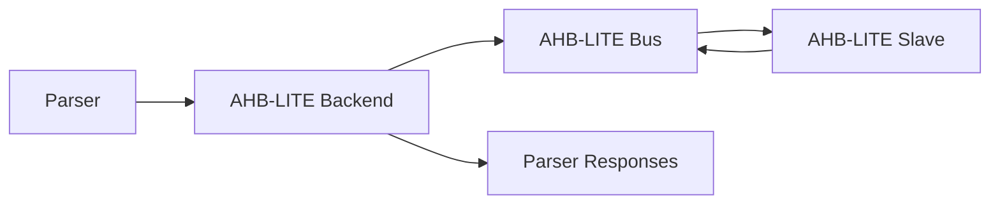

# DexterLab AHB-LITE Backend

The AHB-LITE backend converts high-level parser commands (`t_cmd_out`) into AHB-LITE bus transactions and translates bus responses back into parser responses (`t_rsp_in`).

It provides a lightweight AHB implementation while preserving the full parser command model.

Supported operations include:

- SINGLE transfers
- Multi-beat transfers
- FIFO transactions
- WRAP address generation
- Timeout detection
- Protocol validation
- Error propagation

Unlike AHB-FULL, AHB-LITE does not provide the HBURST signal. Burst execution is therefore managed entirely by the backend through address generation and HTRANS sequencing.

---

# 1. Overview

The backend receives commands from the parser/arbiter infrastructure and executes them over an AHB-LITE bus.

Supported command families include:

- WRITE
- READ
- CHECK
- BURST_WRITE
- BURST_READ
- BURST_CHECK
- WRAP_WRITE
- WRAP_READ
- WRAP_CHECK
- FIFO_WRITE
- FIFO_READ
- FIFO_CHECK

The parser command model remains unchanged.

The backend adapts those commands to AHB-LITE semantics.

---

# 2. Architecture



The parser remains bus-independent.

The backend performs protocol translation.

---

# 3. AHB-LITE Signals

## Address and Control

- HADDR
- HWRITE
- HSIZE
- HTRANS
- HREADY
- HRESP

## Write Data

- HWDATA

## Read Data

- HRDATA

Unlike AHB-FULL:

```text
HBURST is not present.
```

---

# 4. Command Mapping

| Command Field | AHB-LITE Usage |
|---------------|----------------|
| cmd_write | HWRITE |
| cmd_addr | HADDR |
| cmd_size | HSIZE |
| cmd_len | Transfer length |
| cmd_burst | Internal sequencing |
| cmd_wrap | Internal address generation |
| cmd_data | HWDATA |
| cmd_id | Response correlation |
| cmd_wstrb | Validation only |

---

# 5. Backend State Machine

The AHB-LITE backend uses the same execution architecture as the AHB-FULL backend.

```text
IDLE

WR_ADDR
WR_DATA
WR_RESP

RD_ADDR
RD_DATA
RD_RESP

ERR_DRAIN
```

State purposes:

| State | Description |
|---------|-------------|
| IDLE | Wait for new command |
| WR_ADDR | Write address phase |
| WR_DATA | Write data phase |
| WR_RESP | Write response phase |
| RD_ADDR | Read address phase |
| RD_DATA | Read data phase |
| RD_RESP | Read response phase |
| ERR_DRAIN | Synthetic execution phase for pre-bus errors |

---

# 6. Internal Response Pipeline

The backend uses the unified response architecture.

```text
Phase 1
--------
Command execution

WR_DATA
RD_DATA
ERR_DRAIN

Phase 2
--------
Response publication

WR_RESP
RD_RESP

Phase 3
--------
Ready for next command

IDLE
```

This architecture is shared with all supported bus converters.

---

# 7. HTRANS Sequencing

Transfers follow standard AHB-LITE rules.

First beat:

```text
HTRANS = NONSEQ
```

Following beats:

```text
HTRANS = SEQ
```

Example:

```text
Beat 0 -> NONSEQ
Beat 1 -> SEQ
Beat 2 -> SEQ
Beat 3 -> SEQ
```

---

# 8. Multi-Beat Operation

AHB-LITE does not provide HBURST information.

The backend therefore:

- Tracks burst length internally
- Tracks current beat internally
- Generates next addresses internally
- Generates wrap addresses internally

The slave is not informed of burst length or burst type.

---

# 9. Address Generation

## Incrementing Transfers

```text
addr
addr + size
addr + 2*size
addr + 3*size
...
```

## Wrapping Transfers

Wrap address computation is performed entirely inside the backend.

The slave only observes the generated addresses.

---

# 10. Wait-State Handling

The backend fully supports:

```text
HREADY = 0
```

When a slave inserts wait states the current transfer remains active until:

```text
HREADY = 1
```

---

# 11. Timeout Handling

The timeout counter is active during:

```text
WR_ADDR
WR_DATA
RD_ADDR
RD_DATA
```

and reports:

```text
AHB_LITE TIMEOUT
```

if the transfer does not complete.

---

# 12. Error Handling

AHB-LITE supports only:

```text
OKAY
ERROR
```

The backend maps:

| HRESP | Parser Error |
|---------|-------------|
| 0 | AHB_LITE OKAY |
| 1 | AHB_LITE ERROR |

Additional parser-side errors include:

- AHB_LITE TIMEOUT
- AHB_LITE PROT_ERR
- AHB_LITE BOUNDARY_ERR
- AHB_LITE BURST_ERR
- AHB_LITE WSTRB_ERR

Error reports include:

- code
- address
- beat index
- command ID

---

# 13. Response Generation

Responses returned to the parser include:

```text
rsp_valid
rsp_last
rsp_data

rsp_err_valid
rsp_err_code
rsp_err_addr
rsp_err_beat

rsp_end_cmd
```

This enables:

- command completion tracking
- diagnostic logging
- error reporting
- response correlation

---

# 14. Atomic Mode

Atomic execution is handled by the arbiter.

The backend executes commands in the order received.

---

# 15. Validation Status

Validated through complete regression suites including:

- Parser tests
- FIFO tests
- Burst tests
- Wrap tests
- Poll tests
- Dump tests
- AHB-LITE error tests

Reference result:

```text
TOTAL EXEC ERRORS = 0
TOTAL ERRORS      = 0
SIMULATION RESULT = OK
```

---

# 16. Summary

The AHB-LITE backend:

- Converts parser commands into AHB-LITE transactions
- Supports SINGLE and multi-beat transfers
- Supports WRAP address generation
- Operates without HBURST
- Handles wait states and timeouts
- Propagates bus errors
- Implements the unified three-phase response pipeline
- Returns structured responses through `t_rsp_in`

It provides a complete AHB-LITE implementation while preserving the common DexterLab parser architecture.

---

# End of Document
