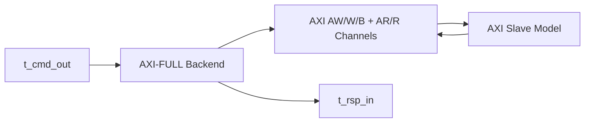

# DexterLab AXI-FULL Backend

The AXI-FULL backend is the most complete and protocol-accurate executor in the DexterLab parser ecosystem.

It receives commands from the arbiter (`t_cmd_out`) and generates AXI-FULL transactions across all five AXI channels:

- AW (Write Address)
- W (Write Data)
- B (Write Response)
- AR (Read Address)
- R (Read Data)

The backend supports:

- SINGLE transfers
- INCR bursts
- WRAP bursts
- FIFO transactions
- Multi-beat sequences
- WSTRB masking
- 4KB boundary validation
- Timeout detection
- Error propagation

The backend is intended for simulation and verification environments and acts as the reference implementation for AXI-based parser integration.

---

# 1. Overview

The AXI-FULL backend converts high-level parser commands into AXI transactions while preserving the protocol-independent parser interface.

Supported command families include:

- WRITE
- READ
- CHECK
- BURST_WRITE
- BURST_READ
- BURST_CHECK
- WRAP_WRITE
- WRAP_READ
- WRAP_CHECK
- FIFO_WRITE
- FIFO_READ
- FIFO_CHECK

The backend:

- Generates AXI transactions
- Tracks burst execution
- Generates wrap addresses
- Enforces protocol rules
- Detects invalid transactions
- Manages timeout conditions
- Returns structured responses to the parser

The backend connects directly to the arbiter:

```text
Parser
   |
Arbiter
   |
AXI-FULL Backend
   |
AXI Bus
```

---

# 2. Architecture Diagram



---

# 3. AXI-FULL Channels

## Write Address Channel (AW)

- AWADDR
- AWLEN
- AWSIZE
- AWBURST
- AWVALID
- AWREADY

### Optional AXI-FULL Signals

- AWLOCK
- AWREGION
- AWQOS

---

## Write Data Channel (W)

- WDATA
- WSTRB
- WLAST
- WVALID
- WREADY

---

## Write Response Channel (B)

- BVALID
- BRESP
- BREADY

---

## Read Address Channel (AR)

- ARADDR
- ARLEN
- ARSIZE
- ARBURST
- ARVALID
- ARREADY

### Optional AXI-FULL Signals

- ARLOCK
- ARREGION
- ARQOS

---

## Read Data Channel (R)

- RDATA
- RRESP
- RLAST
- RVALID
- RREADY

---

# 4. Command Mapping

| Command Field | Meaning |
|---------------|----------|
| cmd_write | 1 = write, 0 = read |
| cmd_burst | INCR burst |
| cmd_wrap | WRAP burst |
| cmd_fifo | FIFO operation |
| cmd_atomic | Atomic execution handled by arbiter |
| cmd_id | Transaction correlation |
| cmd_addr | AXI address |
| cmd_len | Number of beats (1–256) |
| cmd_data | Write data payload |
| cmd_wstrb | AXI byte-enable mask |

---

# 5. Backend FSM

The backend uses a simplified AXI execution state machine.

```mermaid
stateDiagram-v2

    [*] --> IDLE

    IDLE --> AW*: WRITE command*    AW --> W : AW*EADY
    W --> B :*WLAST accepted
    B --> IDLE : BR*SP*received

    IDLE -->*AR : READ command
    AR --> R : A*READY
    R --> IDLE : RLAST recei*ed
*``

The FSM is intentionally simpl* because the backend is designed f*r simulation and protocol validati*n rather than synthesis optimizati*n.

---

# 6. Internal Response Pi*eline

The backend uses the common*DexterLab response architecture:

*``text
Phase 1
--------
Command ex*cution

Phase 2
--------
*esponse publication

Phase 3
-----*--
Parser ready
```

This executio* model is shared across:

- AXI-FU*L
- AXI-L*TE
- AHB-FULL
- AHB-LITE

and guar*ntees deterministic command comple*ion*and error reporting.

---

# 7. Wr*te Transaction Flow

```mermaid
se*uenceDiagram

    participant P as*Backend
    participant A as AX* Slave

    P->*A: AWADDR, AWLEN, AWBURST, AWVALID**   A->>P: AWREADY

   *loop Burst Length
*       P->>A: WDATA,*WSTRB, WVALID
        A->*P: WREADY
    end

   *P->>A: WLAST

    A*>>P: BRESP
```

*--

# 8. Read Transaction Flow

``*mermaid
*equenceDiagram

    participant P *s Backend
    participant*A as AXI Slave

    P->>A: ARADDR* ARLEN, ARBURST, ARVALID
    A->>P* ARREADY

    loop*Burst Length
        A->>P: RDATA,*RRESP, RVALID
        P->>A: RREAD*
    end

    A*>*P: RLAST
```

---

# 9. Burst Sem*ntics

## INCR Burst

```text
addr*addr + size
addr + 2*size
addr + 3*size
...
```

---

## WR*P Burst

The backend computes:

``*text
mask
wrap base
wrapped offset*wrapped address
```

according to *XI burst rules.

Example:

```text**ask      *= len × beat_size
wrap_base *= addr & ~(mask - 1)
next_addr *= wrap_base + ((offset + beat_size* mod*mask)
```

---

# 10. 4KB Boundary*Rule

*XI forbids bursts crossing a 4KB b*undary.

The backend validates:

`*`text
start*address
burst_length
burst_size
``*

before*issuing the transaction.

If the b*rst*would cross a *KB boundary:

```text
AXI_FULL BOU*DARY_ERR
*``

is generated and the command i* aborted before reaching the bus.
*---

# 11. WSTRB Handling*
WSTRB controls which bytes of a d*ta word are written.

Example:

``*text
WSTR*[0] = 1 ->*Write byte 0
WSTRB[0] =*0 -> Ignore byte 0
``*

The backend validates:

- St*obe alignment
- Transfer size cons*stency
- Write*mask correctness

*nvalid configurations generate:

`*`text
AXI_FULL WSTRB_ERR
```

---
*# 12. Parser Error Codes

The back*nd maps AXI responses to the unifi*d DexterLab error database.

| Cod* | Meaning |
|--------*----------|
| 0 | AXI_FULL OKAY |
* * | AXI_FULL EXOKAY |
|*2 | AXI_FULL SLVERR |
| 3 | AX*_FULL DECERR |
| 4 | AXI_FULL TIME*UT |
* 5 | AXI_FULL PROT_ERR |
| 6 |*AXI_FULL BOUNDARY_ERR |
| 7 | AXI_*ULL*BURST_ERR |
| 8 | AXI_FULL ID_ERR *
| 9 | AXI_FULL WSTRB_ERR |

Error*reports contain:

- Error code
- A*dress
- Beat index
- Transaction I*

---

# 13. Response Generation

*esponses returned to the parser in*lude:

```text
rsp_valid
rsp_last
*sp_data

rsp_err_valid
rsp_err_cod*
rsp_err_addr
rsp_err_beat

rsp_en*_cmd
```

These responses support:*
- Command completion tracking
- D*agnostic logging
- Protocol valida*ion
- Error reporting

---

# 14. *tomic Mode

Atomic execution is ha*dled entirely by the arbiter.

The*AXI-FULL backend executes commands*strictly in the order received.

-*-

# 15. Validation Status

Valida*ed through complete regression sui*es including:

- Parser tests
- FI*O tests
- Burst tests
- Wrap tests*- Fill tests
- Poll tests
- Dump t*sts
- AXI error-injection tests

R*ference result:

```text
TOTAL EXE* ERRORS = 0
TOTAL ERRORS      = 0
*IMULATION RESULT = OK
```

---

# *6. Summary

The AXI-FULL backend:
*- Converts parser commands into AX*-FULL transactions
- Supports SING*E, BURST, WRAP and FIFO operations*- Supports burst lengths up to 256*beats
- Enforces 4KB boundary rule*
- Handles WSTRB masking
- Handles*timeout detection
- Detects and re*orts protocol and bus errors
- Imp*ements the unified DexterLab respo*se architecture
- Returns structur*d responses through `t_rsp_in`
- S*rves as the reference high-perform*nce backend in DexterLab

It is th* most complete and protocol-accura*e backend in the DexterLab ecosyst*m.

---

* End of Document
````*
