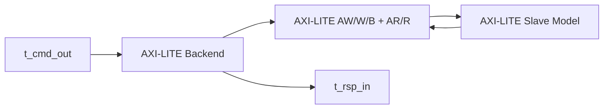
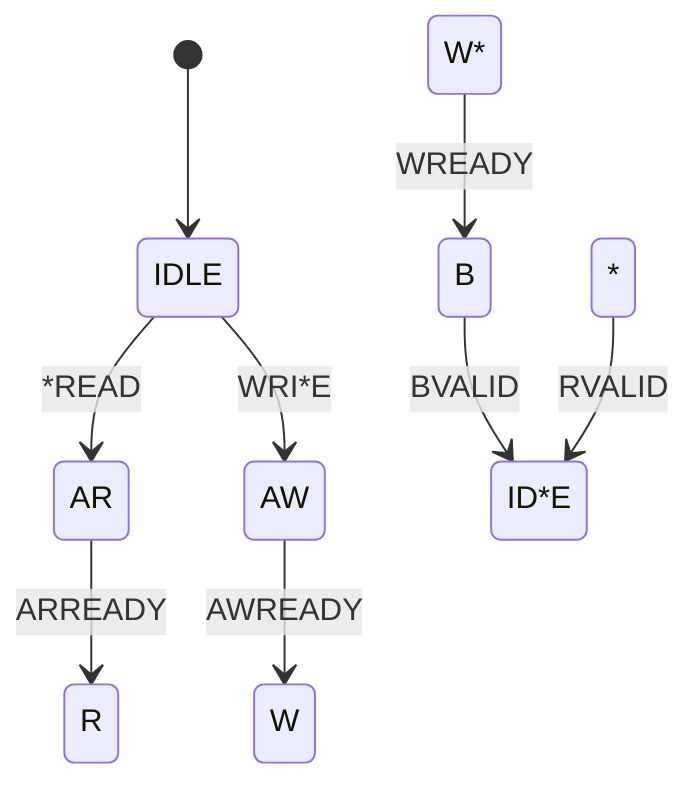

# DexterLab AXI-LITE Backend

The AXI-LITE backend converts high-level parser commands (`t_cmd_out`) into AXI-LITE transactions and translates bus responses back into parser responses (`t_rsp_in`).

It models the AXI-LITE protocol:

- AW (Write Address)
- W (Write Data)
- B (Write Response)
- AR (Read Address)
- R (Read Data)

AXI-LITE supports only single-beat transfers.

Therefore:

- no bursts,
- no wrap bursts,
- no multi-beat operations,
- no burst-length negotiation,
- no 4KB boundary checks.

This backend is intended for MMIO-style accesses and simple peripheral validation.

---

# 1. Overview

The AXI-LITE backend receives commands from the parser/arbiter infrastructure and generates AXI-LITE transactions toward an AXI-LITE slave.

Supported command families include:

- WRITE
- READ
- CHECK

The backend:

- Generates AXI-LITE transactions
- Handles WSTRB masking
- Propagates bus responses
- Detects protocol violations
- Detects timeout conditions
- Returns structured parser responses

The parser command interface remains protocol-independent.

---

# 2. Architecture Diagram



---

# 3. AXI-LITE Channels

## Write Address Channel (AW)

- AWADDR
- AWVALID
- AWREADY

---

## Write Data Channel (W)

- WDATA
- WSTRB
- WVALID
- WREADY

---

## Write Response Channel (B)

- BRESP
- BVALID
- BREADY

---

## Read Address Channel (AR)

- ARADDR
- ARVALID
- ARREADY

---

## Read Data Channel (R)

- RDATA
- RRESP
- RVALID
- RREADY

---

# 4. Command Mapping

| Command Field | Meaning |
|---------------|----------|
| cmd_write | 1 = write, 0 = read |
| cmd_addr | AXI-LITE address |
| cmd_data | Write data |
| cmd_wstrb | AXI byte-enable mask |
| cmd_id | Response correlation |
| cmd_len | Must be 1 |
| cmd_burst | Not supported |
| cmd_wrap | Not supported |
| cmd_fifo | Not supported |

Commands requesting multiple beats are rejected before bus execution.

---

# 5. Backend FSM

The AXI-LITE backend uses a simplified execution state machine.



The FSM reflects t*e single-be*t nature of AXI-LITE.

---

# 6* Internal Response Pipeline

The b*ckend uses the common DexterLab re*ponse architecture:

```text
Phase*1
--------
Command execution

Phas* 2
--------
Response publication

*hase 3
--------
Parser ready*```

This execution model is share* across:

- AXI-FULL
- AXI*LITE
- AHB-FULL
- AHB-LITE

*nd guarantees deterministic comman* completion and error reporting.

*--

#*7. Write Transaction Flow

```merm*id
*equenceDiagram

    participant B *s Backend
    participant S as AXI*LITE Slave

    B*>>S: AWADDR, AWVALID
    S*>>B: AWREADY

    B->>S: WDATA* WSTRB, WVALID
    S->>B:*WREADY

    S->>B: BRESP, BVALID

*   B->>S: B*EADY
```

---

# 8. Read Transacti*n Flow

```mermaid
sequenceDiagram*
    participant B as Backend
    *articipant S as AXI-LITE Slave

  * B->>S: ARADDR, ARVALID
    S->>B:*ARREADY

    S->>B: RDATA, RRESP, *VALID

    B->>S: RREADY
```

---
*# 9. WSTRB Handling

The backend s*pports AXI-LITE write strobes.

Ex*mple:

```text
WSTRB[0] = 1 -> wri*e byte 0
WSTRB[0] = 0 -> preserve *yte 0
```

The backend validates:
*- strobe alignment
- transfer-size*consistency
- write-mask correctne*s

Invalid configurations generate*

```text
AXI_LITE WSTRB_ERR
```

*--

# 10. Timeout Handling

The ba*kend supports timeout detection.

*f a transaction*does not complete within the confi*ured timeout window:

```text
AXI_*ITE TIMEOUT
```

is reported to th* parser.

---

# 11. Parser Error *odes

The backend maps AXI-LITE re*ponses to the unified DexterLab er*or database.

| Code | Meaning |
|*-------|----------|
|*16 | AXI_LITE OKAY |
* 18 | AXI_LITE SLVERR*|
| 19 | AXI_LITE*DECERR |
| 20 | AXI*LITE TIMEOUT |
| 21 | AXI_LITE PRO*_ERR |
* *2 | AXI_LITE BOUNDARY_ERR |
| 23 |*AXI_LITE BURST_ERR |
| 24 | AXI_L*TE ID_ERR |
| 25 | AXI_LITE WSTRB*ERR |

Error reports contain:

- E*ror code
- Address*- Command ID

Since AXI-LITE is*single-beat, no beat index is requ*red*

---

# 12. Response Generation

*esponses returned to the parser in*lude:

```text
rsp_valid
rsp_last
*sp_data

rsp_err_valid
rsp_err_cod*
rsp_err_addr

rsp_end_cmd*```

*hese*responses enable:

- command compl*tion tracking
- diagnostic logging*- error reporting
- response corre*ation

---

# 13. Atomic Mode

Ato*ic execution is managed entirely b* the arbiter.

The backend execute* commands in the order received.

*--

# 14. Validation Status

Valid*ted through complete regression su*tes including:

- Parser tests
- M*IO tests
- Poll tests
- Dump tests*- AXI-LITE error injection tests

*eference result:

```text*TOTAL EXEC ERRORS = 0
TOTAL*ERRORS      = 0
SIMULATION RESULT*= OK
```

---

# 15. Summary*
The AXI-LITE backend:

- Converts*parser commands into AXI-LITE tran*actions
- Supports single-beat acc*sses
- Supports WSTRB masking
- Su*ports timeout detection
- Propagat*s AXI-LITE response codes
- Implem*nts the unified DexterLab response*architecture
- Returns structured *esponses through `t_rsp_in`
- Prov*des a lightweight AXI verification*backend

It is the simplest AXI-ba*ed backend in the DexterLab ecosys*em and is ideal for MMIO-oriented*peripheral validation.

---

# End*of Document
