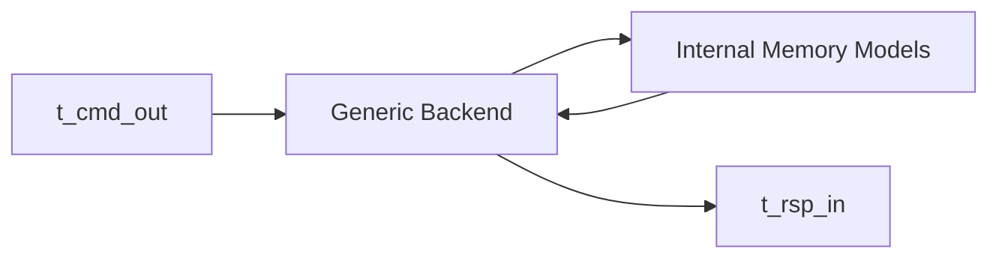

# DexterLab Generic Backend

The Generic Backend is the reference execution backend for the DexterLab command ecosystem.

Unlike AXI-FULL, AXI-LITE, AHB-FULL, and AHB-LITE backends, the Generic Backend does not implement a physical communication protocol.

Instead, it executes commands directly against simulation memory models using the standard DexterLab interfaces.

The Generic Backend is primarily intended for:

- Parser validation
- Command verification
- Arbiter testing
- Regression testing
- Continuous integration
- Simulation-based development
- Error-path verification

The Generic Backend serves as the simplest and fastest execution environment available within DexterLab.

---

# 1. Overview

The Generic Backend executes commands received through the standard DexterLab command interfaces:

```text
t_cmd_out
t_rsp_out
t_rsp_in
```

The backend follows the same execution model used by all other DexterLab backends while removing bus-protocol complexity.

Execution path:

```text
Command Source
      |
      v
   Arbiter
      |
      v
 Generic Backend
      |
      v
 Internal Memory Models
```

No AXI, AHB, APB, TileLink, or external bus signals are involved.

---

# 2. Architecture

The Generic Backend operates directly on simulation models.



All execution is performed inside the backend.

No protocol conversion layer exists.

---

# 3. Execution Model

The Generic Backend follows the common DexterLab execution model.

```text
Phase 1
--------
Command execution

Phase 2
--------
Response publication

Phase 3
--------
Command completion
```

Command completion is reported through:

```text
rsp_end_cmd
```

This keeps Generic Backend behavior aligned with:

- AXI-FULL
- AXI-LITE
- AHB-FULL
- AHB-LITE

---

# 4. Internal Memory Models

The backend contains internal simulation memory structures.

Typical resources include:

```text
Register Model
RAM Model
FIFO Model
```

These models implement the address map defined in:

```text
DexterLab Address Map.md
```

Address regions:

| Region | Range |
|----------|----------|
| REG | 0x0000–0x001F |
| RAM | 0x1000–0x2FFF |
| FIFO_WRITE | 0x3000 |
| FIFO_READ | 0x3100 |

---

# 5. Supported Commands

The Generic Backend supports all standard DexterLab command families.

---

## Basic Commands

```text
READ
WRITE
CHECK
WSTRB_WRITE
```

---

## Burst Commands

```text
BURST_READ
BURST_WRITE
BURST_CHECK
```

---

## Wrap Commands

```text
WRAP_READ
WRAP_WRITE
WRAP_CHECK
```

---

## FIFO Commands

```text
FIFO_READ
FIFO_WRITE
FIFO_CHECK
```

---

## Fill Commands

```text
FILL_LEN
FILL_RANGE
FILL_CHECK
```

---

## Poll Commands

```text
POLL_READ
POLL_TOGGLE
```

---

## Dump Commands

```text
DUMP_LEN
DUMP_RANGE

DUMP_FILE_LEN
DUMP_FILE_RANGE

DUMP_FILE_CHECK_LEN
DUMP_FILE_CHECK_RANGE
```

---

## Error Injection

```text
TEST_ERROR
```

---

# 6. Command Processing

Commands are executed immediately against internal memory models.

Example:

```text
WRITE 0x1000 0x12345678
```

results in:

```text
RAM[0x1000] := 0x12345678
```

without requiring any external bus transaction.

Similarly:

```text
READ 0x1000
```

returns:

```text
rsp_data
```

generated directly from the internal memory model.

---

# 7. Register Region Support

The register model represents:

```text
REG0
REG1
REG2
REG3
REG4
REG5
REG6
REG7
```

located in:

```text
0x0000 – 0x001F
```

Characteristics:

- Single-beat operation
- Deterministic responses
- No burst behavior
- No wrap behavior

Ideal for control/status validation.

---

# 8. RAM Support

The RAM model is the primary execution target.

Address range:

```text
0x1000 – 0x2FFF
```

Capabilities:

- READ
- WRITE
- CHECK
- WSTRB_WRITE
- Burst transfers
- Wrap transfers
- Fill operations
- Dump operations
- Poll operations

The RAM model allows validation of nearly all parser features.

---

# 9. Burst Support

The Generic Backend supports incrementing burst operations.

Examples:

```text
BURST_READ
BURST_WRITE
BURST_CHECK
```

The backend executes each beat sequentially against internal memory.

Typical validation targets include:

- Burst sequencing
- Length handling
- Response generation
- Error propagation

---

# 10. Wrap Support

The Generic Backend supports wrap commands.

Supported operations:

```text
WRAP_READ
WRAP_WRITE
WRAP_CHECK
```

The parser validates wrap legality before execution.

The backend implements wrap addressing internally using its own addressing logic.

This behavior mirrors the architecture used by protocol-specific backends.

---

# 11. FIFO Support

Dedicated FIFO endpoints are provided.

| Endpoint | Address |
|----------|----------|
| FIFO_WRITE | 0x3000 |
| FIFO_READ | 0x3100 |

Supported operations:

```text
FIFO_WRITE
FIFO_READ
FIFO_CHECK
```

Capabilities:

- Push operations
- Pop operations
- FIFO validation
- Empty detection
- Full detection

The FIFO model is useful for streaming and queue-related testing.

---

# 12. Polling Support

The Generic Backend supports:

```text
POLL_READ
POLL_TOGGLE
```

These commands execute through the standard command model.

Polling continues until:

- Success condition is met
- Maximum attempts reached
- Execution error occurs

This provides a deterministic environment for validating polling behavior.

---

# 13. Fill Operations

Supported operations:

```text
FILL_LEN
FILL_RANGE
FILL_CHECK
```

Typical uses:

- Memory initialization
- Stress testing
- Pattern generation
- Verification support

Common patterns:

```text
0x00000000
0xFFFFFFFF
0xAAAAAAAA
0x55555555
0xDEADBEEF
```

---

# 14. Dump Operations

Supported commands:

```text
DUMP_LEN
DUMP_RANGE

DUMP_FILE_LEN
DUMP_FILE_RANGE

DUMP_FILE_CHECK_LEN
DUMP_FILE_CHECK_RANGE
```

Capabilities:

- Read memory contents
- Generate dump files
- Compare against reference files
- Simplify debugging

These operations are widely used during regression testing.

---

# 15. Response Generation

Responses are returned through:

```text
t_rsp_in
```

Including:

```text
rsp_valid
rsp_last
rsp_data

rsp_err_valid
rsp_err_code
rsp_err_addr
rsp_err_beat
rsp_err_id

rsp_end_cmd
```

The response model is identical to other DexterLab backends.

---

# 16. Error Handling

Errors are reported through the unified DexterLab error infrastructure.

Possible categories include:

- Address errors
- Boundary errors
- Burst errors
- FIFO errors
- Polling failures
- Verification failures

Error reporting uses:

```text
rsp_err_valid
rsp_err_code
rsp_err_addr
rsp_err_beat
rsp_err_id
```

Complete error definitions are documented in:

```text
cmd_errors.md
```

---

# 17. Locked Command Sequences

The Generic Backend does not implement ownership management.

Ownership protection is handled by the arbiter through:

```text
cmd_lock
```

The backend simply executes commands in the order received.

This behavior is consistent across all DexterLab backends.

---

# 18. Verification Applications

The Generic Backend is particularly useful for:

- Parser development
- Arbiter debugging
- Command validation
- Error-path testing
- Continuous integration
- Documentation examples
- Educational environments

Because no protocol implementation is required, simulations are typically much faster than AXI or AHB environments.

---

# 19. Limitations

The Generic Backend is not intended to verify:

- AXI timing
- AXI handshakes
- AHB timing
- Protocol-specific wait states
- Protocol-specific signaling

These aspects must be validated using the corresponding protocol backend.

---

# 20. Summary

The Generic Backend is the reference execution backend for DexterLab.

It:

- Executes commands directly on simulation memory models
- Supports all major DexterLab command families
- Implements the common response model
- Provides deterministic behavior
- Integrates with the arbiter
- Supports FIFO, burst, wrap, polling, fill and dump operations
- Uses the unified DexterLab error model
- Provides the fastest verification environment available

The Generic Backend remains the preferred platform for parser development, regression testing, and command validation before moving to protocol-specific backends.

---

# End of Document
