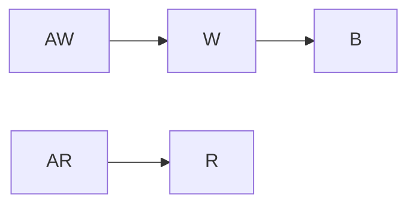
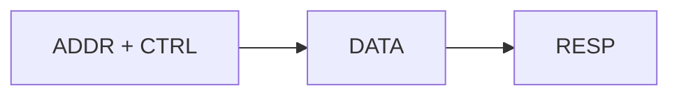
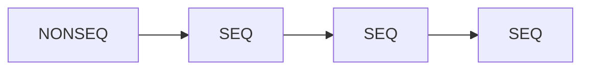

# DexterLab Bus Comparison Guide

This document provides a unified comparison of the bus protocols supported by DexterLab through its backend executors:

- AXI-FULL
- AXI-LITE
- AHB-FULL
- AHB-LITE
- TileLink (UL/UH)

The goal is to provide developers with a clear understanding of the strengths, limitations, architectural characteristics, and intended use cases of each protocol when used with the DexterLab command parser.

---

# 1. Overview

DexterLab supports multiple bus protocols through dedicated backend modules.

| Protocol | Backend Module |
|----------|----------------|
| AXI-FULL | `backend_axi_full` |
| AXI-LITE | `backend_axi_lite` |
| AHB-FULL | `backend_ahb_full` |
| AHB-LITE | `backend_ahb_lite` |
| TileLink | `tilelink_bridge` |

All protocols share the same parser-side interface:

```text
t_cmd_out
    |
Arbiter
    |
Backend
    |
Bus Protocol
    |
t_rsp_in
```

Backends connect directly to the arbiter.

Wrappers are no longer required.

---

# 2. Common Architecture

All supported protocols use the same execution model.

```text
Parser
   |
Arbiter
   |
Backend
   |
Bus
```

and the same response architecture:

```text
Phase 1
--------
Command execution

Phase 2
--------
Response publication

Phase 3
--------
Parser ready
```

This approach guarantees consistent command behavior across all supported bus protocols.

---

# 3. High-Level Comparison

| Feature | AXI-FULL | AXI-LITE | AHB-FULL | AHB-LITE | TileLink |
|----------|----------|----------|----------|----------|----------|
| Multi-beat transfers | ✔ | ✘ | ✔ | ✔ | ✔ (UH) |
| Wrap addressing | ✔ | ✘ | ✔ | ✔ | ✔ (UH) |
| WSTRB / byte masking | ✔ | ✔ | ✘ | ✘ | ✔ |
| Separate channels | ✔ | ✔ | ✘ | ✘ | ✔ |
| Wait-state support | ✔ | ✔ | ✔ | ✔ | ✔ |
| Timeout detection | ✔ | ✔ | ✔ | ✔ | Protocol dependent |
| Atomic execution | Via arbiter | Via arbiter | Via arbiter | Via arbiter | Native |
| Explicit burst information | ✔ | ✘ | ✔ | ✘ | Protocol defined |
| 4KB boundary validation | ✔ | ✘ | Configurable | Configurable | ✘ |
| Error reporting richness | High | Medium | Medium | Medium | Low |
| Performance potential | ★★★★★ | ★★☆☆☆ | ★★★★☆ | ★★★☆☆ | ★★★★☆ |
| Protocol complexity | High | Low | Medium | Medium | Medium / High |

---

# 4. AXI-FULL

AXI-FULL is the most powerful protocol currently supported by DexterLab.

## Strengths

- Multi-beat bursts
- Wrap bursts
- WSTRB masking
- Independent read and write channels
- High throughput
- Rich response model
- Large burst lengths (up to 256 beats)

## Limitations

- Most complex backend
- Strict VALID/READY handshakes
- 4KB boundary restriction
- Larger signal count

## Best Use Cases

- High-performance memory systems
- DMA engines
- Large SoCs
- Advanced FPGA designs
- AXI interconnect-based systems

## DexterLab Implementation

Handled by:

```text
backend_axi_full
```

---

# 5. AXI-LITE

AXI-LITE is a simplified subset of AXI intended for register-oriented accesses.

## Strengths

- Simple protocol
- WSTRB support
- Small signal count
- Easy integration
- Ideal for MMIO peripherals

## Limitations

- Single-beat only
- No bursts
- No wrapping transactions
- Lower throughput

## Best Use Cases

- Configuration registers
- Status registers
- Low-bandwidth peripherals
- Control interfaces

## DexterLab Implementation

Handled by:

```text
backend_axi_lite
```

---

# 6. AHB-FULL

AHB-FULL provides burst capability with a simpler bus structure than AXI.

## Strengths

- Multi-beat bursts
- Wrap bursts
- Deterministic timing
- Simpler signaling than AXI
- Explicit burst information through HBURST

## Limitations

- No WSTRB support
- Shared address/data pipeline
- Less transaction flexibility than AXI

## Best Use Cases

- Deterministic embedded systems
- MCU-class SoCs
- FPGA subsystems
- Verification environments

## DexterLab Implementation

Handled by:

```text
backend_ahb_full
```

Supports:

- SINGLE
- BURST
- WRAP
- FIFO
- Timeout detection
- Full parser error reporting

---

# 7. AHB-LITE

AHB-LITE is a simplified derivative of AHB-FULL.

Unlike AHB-FULL, it does not include the HBURST signal and therefore does not explicitly communicate burst length or burst type to the slave.

The DexterLab implementation preserves the complete high-level parser model and performs sequencing internally.

## Strengths

- Simpler interface than AHB-FULL
- Multi-beat transfers supported
- Wrap addressing supported
- Deterministic timing
- Easy integration
- Minimal bus interface

## Limitations

- No HBURST signal
- No SPLIT responses
- No RETRY responses
- No multi-master support
- Slave does not know burst length in advance

## Best Use Cases

- Lightweight SoCs
- Embedded microcontrollers
- Verification environments
- Memory-mapped peripherals

## DexterLab Implementation

Handled by:

```text
backend_ahb_lite
```

The backend internally generates:

- NONSEQ / SEQ sequences
- Incrementing addresses
- Wrap addresses

while exposing a standard AHB-LITE interface to the bus.

---

# 8. TileLink (UL/UH)

TileLink is the native interconnect protocol of many RISC-V systems.

## Strengths

- Multi-beat transfers (UH)
- Wrap-style address behavior
- Byte masking
- Native atomic operations
- Scalable architecture
- Cache-coherent variants

## Limitations

- More complex than AXI-LITE and AHB-LITE
- Requires bridge logic in mixed systems
- Protocol-specific terminology

## Best Use Cases

- RISC-V SoCs
- Cache-coherent systems
- Modern interconnect fabrics
- Research and custom architectures

## DexterLab Implementation

Handled through:

```text
tilelink_bridge
```

which converts TileLink traffic into the internal parser command model.

---

# 9. Protocol Diagrams

## AXI-FULL



---

## AHB-FULL



---

## AHB-LITE



Burst sequencing exists, but burst metadata is not explicitly communicated through HBURST.

---

## TileLink


---

# 10. Selecting a Backend

| Requirement | Recommended Protocol |
|------------|----------------------|
| Maximum performance | AXI-FULL |
| Register access | AXI-LITE |
| Deterministic bursts | AHB-FULL |
| Lightweight embedded systems | AHB-LITE |
| Native RISC-V environment | TileLink |

---

# 11. Summary

DexterLab supports a wide range of bus protocols through modular backend implementations.

- AXI-FULL → High-performance systems
- AXI-LITE → MMIO and register interfaces
- AHB-FULL → Deterministic burst-capable systems
- AHB-LITE → Lightweight embedded systems with internal burst sequencing
- TileLink → Native RISC-V interconnects

All supported protocols share:

- The same parser interface
- The same arbiter infrastructure
- The same response architecture
- The same logging and error-reporting model

This allows the command parser to remain protocol-independent while supporting multiple bus standards through dedicated backend implementations.

---

# End of Document
