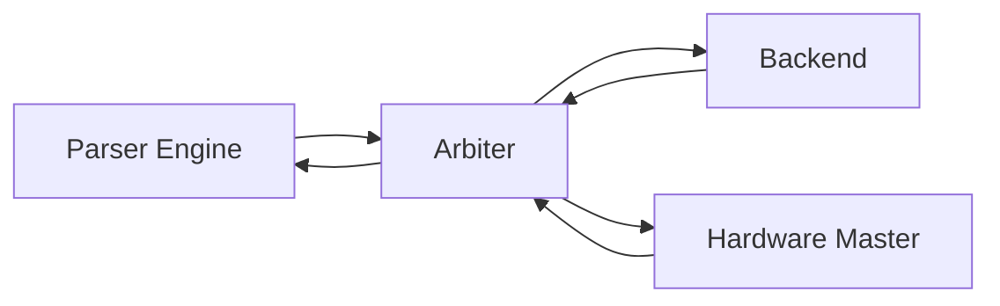

# DexterLab Master + Parser Arbiter

This document provides a high-level overview of the DexterLab arbiter (`arbiter_mux`).

The arbiter is responsible for managing access to the backend layer when multiple command sources are active.

For the complete implementation details, FSM behavior, ownership rules and response routing logic, see:

```text
DexterLab Arbiter Specification.md
```

---

# 1. Overview

The DexterLab arbiter connects command producers to backend executors.

Supported command sources:

- Parser Engine
- Hardware Command Master

Both sources generate:

```text
t_cmd_out
```

receive responses through:

```text
t_rsp_in
```

and control response acceptance through:

```text
t_rsp_out
```

---

# 2. Architecture



---

# 3. Responsibilities

The arbiter is responsible for:

- Source selection
- Command routing
- Response routing
- Pending-command tracking
- Ownership management
- Locked command handling

The backend remains unaware of the command origin.

---

# 4. Command Flow

```text
Parser / Master
        |
        v
     Arbiter
        |
        v
     Backend
        |
        v
       Bus
```

Responses follow the reverse path:

```text
Bus
 |
Backend
 |
Arbiter
 |
Parser / Master
```

---

# 5. Ownership Management

Only one source may own the backend at a time.

The arbiter tracks:

```text
Parser ownership
Master ownership
Pending commands
```

and ensures deterministic execution of all operations.

---

# 6. Locked Command Sequences

Ownership protection is performed through:

```text
cmd_lock
```

When asserted, the arbiter retains ownership for the active source and prevents switching to competing sources until the protected sequence completes.

This mechanism is used by:

```text
SET_ATOMIC
```

within parser command files.

---

# 7. Pending Commands

The arbiter tracks accepted commands until execution completes.

Command completion is indicated through:

```text
rsp_end_cmd
```

After completion:

```text
Ownership may change
Pending state cleared
```

---

# 8. Response Routing

Responses originating from the backend are routed to the source that currently owns the command.

Response information includes:

```text
rsp_valid
rsp_last
rsp_data

rsp_err_valid
rsp_err_code
rsp_err_addr
rsp_err_beat
rsp_err_id

rsp_end_cmd
```

The arbiter does not interpret protocol-specific information.

It only routes responses.

---

# 9. Backend Independence

The arbiter operates identically with:

- Generic Backend
- AXI-FULL Backend
- AXI-LITE Backend
- AHB-FULL Backend
- AHB-LITE Backend

All interactions occur through:

```text
t_cmd_out
t_rsp_out
t_rsp_in
```

---

# 10. Related Documentation

Detailed implementation:

```text
DexterLab Arbiter Specification.md
```

Master integration:

```text
parser_master_integration.md
```

Command interfaces:

```text
cmd_interface.md
```

Command flow:

```text
cmd_flow.md
```

---

# 11. Summary

The DexterLab arbiter provides:

- Multi-source command arbitration
- Ownership tracking
- Pending-command handling
- Locked command support through `cmd_lock`
- Response routing
- Backend-independent operation

It forms the central connection between command producers and backend executors within the DexterLab architecture.

---

# End of Document
