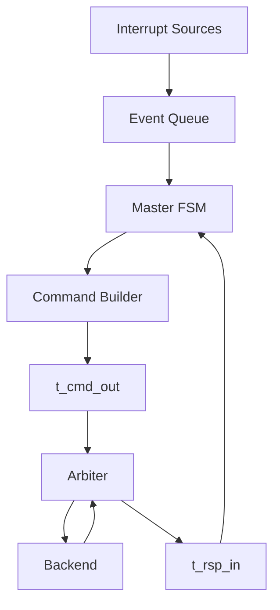

# DexterLab Hardware Command Master (`cmd_master`)

The DexterLab Hardware Command Master (`cmd_master`) is the module responsible for generating hardware-originated commands for the DexterLab command ecosystem.

In the current release (v1.1.0), the module operates as a minimal placeholder implementation intended to validate the complete execution chain:

```text
Master
   |
Arbiter
   |
Backend
   |
Bus
```

Although intentionally simple, the module already integrates fully with the standard DexterLab interfaces and can participate in arbitration exactly like any future hardware command source.

---

# 1. Overview

The current implementation serves as a framework for future hardware-driven command generation.

Its primary goals are:

- Validate arbiter integration
- Validate backend integration
- Exercise the command interface
- Provide a reusable hardware command source
- Establish the architectural foundation for future releases

The module behaves as a valid command producer and uses the same interfaces as all other command sources.

---

# 2. Current Implementation

The current placeholder implementation performs a single operation:

> When `start = '1'`, the master continuously generates a READ transaction at address `0x00000000`.

The generated command is equivalent to:

```text
READ 0x00000000
```

repeated indefinitely while the master remains active.

---

# 3. Current Command Generation

The generated command characteristics are:

| Field | Value |
|---------|---------|
| cmd_write | '0' |
| cmd_burst | '0' |
| cmd_wrap | '0' |
| cmd_fifo | '0' |
| cmd_len | 1 |
| cmd_addr | 0x00000000 |
| cmd_lock | '0' |
| cmd_id | ID_MASTER |

This corresponds to a single-beat non-atomic read transaction.

No bursts, wraps, FIFO accesses, or locked commands are generated.

---

# 4. Response Interface Behavior

The master participates in the standard DexterLab response model.

Interfaces:

```text
t_cmd_out
t_rsp_out
t_rsp_in
```

Current behavior:

```text
t_rsp_out
```

is permanently configured as:

```text
rsp_ready     = 1
rsp_err_ready = 1
```

meaning the master always accepts responses.

The placeholder implementation does not currently process or interpret returned responses.

---

# 5. Current Limitations

The placeholder implementation intentionally excludes:

- Command FSM
- Command queue
- Interrupt handling
- Response processing
- Error recovery
- DMA interaction
- Event scheduling
- Dynamic command generation

It exists only to validate the command path infrastructure.

---

# 6. Integration with the Arbiter

The master is treated exactly like any other command source.

Architecture:

```text
Master
   |
Arbiter
   |
Backend
```

The arbiter receives:

```text
master_valid
master_ready
master_cmd
master_rsp_in
master_rsp_out
```

and arbitrates access against other command producers.

The current implementation therefore validates:

- Ownership switching
- Command routing
- Response routing
- Backend communication

---

# 7. Integration with Backends

The generated commands may be executed by any supported backend:

- Generic Backend
- AXI-FULL
- AXI-LITE
- AHB-FULL
- AHB-LITE

The master itself remains protocol-independent.

It only generates:

```text
t_cmd_out
```

and consumes:

```text
t_rsp_in
```

All protocol-specific behavior remains inside the backend layer.

---

# 8. Current Execution Flow

The placeholder execution sequence is:

```text
start = 1
       |
       v
Master Active
       |
       v
Generate READ(0x00000000)
       |
       v
Arbiter
       |
       v
Backend
       |
       v
Response
       |
       v
Generate next READ
```

This cycle continues while the master remains enabled.

---

# 9. Future Architecture

Future versions will transform the placeholder into a generic event-driven hardware command engine.

High-level architecture:



---

# 10. Planned Features

## Interrupt Handling

Future masters will respond to hardware events such as:

- SPI transfer complete
- I²C transaction complete
- UART RX/TX events
- CAN reception
- Peripheral faults
- DMA completion

---

## Dynamic Command Generation

Commands will be generated according to:

- Interrupt source
- Peripheral state
- Pending requests
- System configuration

Examples:

```text
READ
WRITE
BURST_READ
BURST_WRITE
FIFO_READ
FIFO_WRITE
```

---

## Response Processing

Future implementations will analyze:

```text
rsp_valid
rsp_last
rsp_data

rsp_err_valid
rsp_err_code
rsp_err_addr
rsp_err_beat
rsp_err_id

rsp_end_cmd
```

and react appropriately.

---

## Atomic Execution

Future masters will support locked command sequences through:

```text
cmd_lock
```

allowing the arbiter to preserve ownership during critical operations.

---

## Event-Driven FSM

The placeholder behavior will eventually be replaced by a complete FSM capable of:

- Event detection
- Command creation
- Command submission
- Response evaluation
- Error recovery
- Idle-state management

---

# 11. Potential Future Integrations

Possible hardware command sources include:

- RISC-V processors
- DMA controllers
- SPI controllers
- UART controllers
- I²C controllers
- CAN controllers
- Ethernet controllers
- Custom FPGA accelerators

All future masters will share the same DexterLab command interface.

---

# 12. Design Philosophy

The current implementation intentionally prioritizes:

- Simplicity
- Stability
- Integration testing
- Architectural validation

over functionality.

The goal is to establish a proven command-generation path before introducing protocol-specific hardware intelligence.

---

# 13. Summary

The current `cmd_master` implementation is a minimal hardware command generator that:

- Generates continuous READ transactions at address `0x00000000`
- Integrates with the arbiter
- Integrates with all supported backends
- Uses the standard DexterLab interfaces
- Accepts responses through the standard response path
- Provides a stable foundation for future development

Future releases will expand this placeholder into a fully programmable event-driven hardware command engine capable of interacting with real peripherals through the unified DexterLab command architecture.

---

# End of Document
