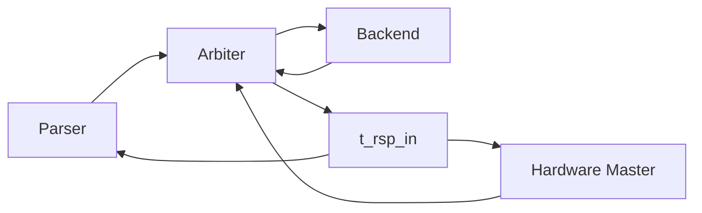
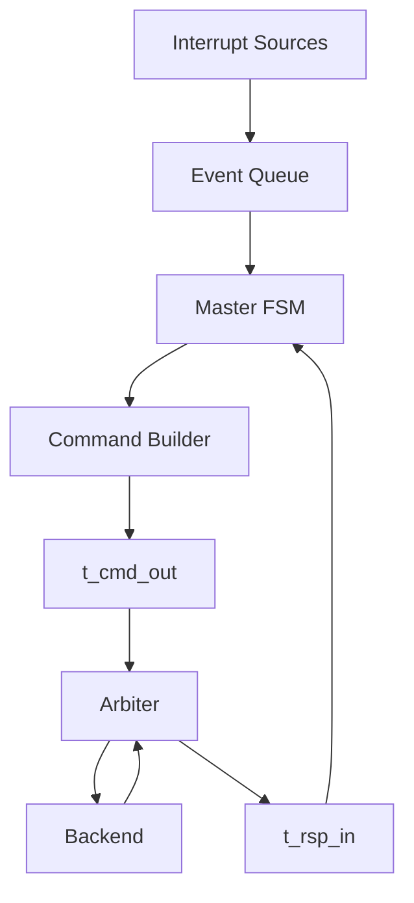

# DexterLab Parser Master Integration Guide

This document describes how to integrate a hardware command generator with the DexterLab command infrastructure.

Supported master types include:

- RISC-V processors
- DMA engines
- FPGA command generators
- Embedded controllers
- Custom state machines

A hardware master uses the same command and response interfaces as the parser and therefore integrates transparently with the arbiter and backend layers.

---

# 1. Overview

The DexterLab architecture supports multiple command sources.

Current sources include:

```text
Parser Engine
Hardware Master
```

Both sources generate:

```text
t_cmd_out
```

and use the same response infrastructure:

```text
t_rsp_out
t_rsp_in
```

Command execution follows the standard architecture:

```text
Command Source
      |
      v
   Arbiter
      |
      v
   Backend
      |
      v
      Bus
```

The backend is completely unaware of the command origin.

---

# 2. Architecture Diagram



The hardware master behaves exactly like the parser from the arbiter's perspective.

---

# 3. Master Interfaces

A hardware master participates in all three DexterLab interface layers.

---

# 3.1 Command Interface (`t_cmd_out`)

The master generates transactions through:

```text
t_cmd_out
```

Core fields include:

| Field | Description |
|---------|-------------|
| cmd_write | Read or write operation |
| cmd_burst | Burst transfer |
| cmd_wrap | Wrap transfer |
| cmd_fifo | FIFO transfer |
| cmd_id | Command identifier |
| cmd_addr | Start address |
| cmd_len | Transfer length |
| cmd_data | Write data |
| cmd_wstrb | Byte enable mask |
| cmd_size | Bytes per beat |
| cmd_prot | Protection attributes |
| cmd_cache | Cache attributes |
| cmd_qos | QoS attributes |
| cmd_lock | Locked execution |
| cmd_err_code | Error injection support |

The generated command is identical to one produced by the parser.

---

# 3.2 Response Control Interface (`t_rsp_out`)

The master indicates its ability to receive responses using:

```text
t_rsp_out
```

Fields:

| Field | Description |
|---------|-------------|
| rsp_ready | Accept response data |
| rsp_err_ready | Accept error reports |

Typical configuration:

```text
rsp_ready     = 1
rsp_err_ready = 1
```

---

# 3.3 Response Interface (`t_rsp_in`)

The backend returns execution results through:

```text
t_rsp_in
```

Fields:

| Field | Description |
|---------|-------------|
| rsp_valid | Valid response |
| rsp_last | Last response beat |
| rsp_data | Read data |
| rsp_id | Command identifier |
| rsp_end_cmd | Command completed |
| rsp_err_valid | Error report valid |
| rsp_err_code | Error code |
| rsp_err_addr | Failing address |
| rsp_err_beat | Failing beat |
| rsp_err_id | Associated command ID |

---

# 4. Handshake Rules

Command acceptance occurs when:

```text
valid = 1
ready = 1
```

The master must:

1. Generate a complete command.
2. Assert command valid.
3. Wait for command acceptance.
4. Remove or update the command after acceptance.

The same protocol is used by the parser.

---

# 5. Arbiter Interaction

The arbiter manages ownership of backend access.

Responsibilities include:

- Source selection
- Ownership tracking
- Response routing
- Locked sequence management

The hardware master is treated exactly like the parser.

---

# 6. Locked Command Sequences

DexterLab supports ownership locking through:

```text
cmd_lock
```

When asserted:

```text
cmd_lock = 1
```

the arbiter preserves ownership for the active source and prevents switching to the competing source.

This mechanism is used for protected command sequences.

---

# 7. Command Examples

## Single Read

```vhdl
cmd_write <= '0';
cmd_addr  <= x"80000000";
cmd_len   <= 1;
```

---

## Single Write

```vhdl
cmd_write    <= '1';
cmd_addr     <= x"80000000";
cmd_len      <= 1;
cmd_data(0)  <= x"DEADBEEF";
```

---

## Burst Read

```vhdl
cmd_write <= '0';
cmd_burst <= '1';
cmd_len   <= 16;
cmd_addr  <= x"80001000";
```

---

## Burst Write

```vhdl
cmd_write <= '1';
cmd_burst <= '1';
cmd_len   <= 16;
```

---

## Locked Sequence

```vhdl
cmd_lock <= '1';
```

Ownership remains assigned to the master until the protected sequence completes.

---

# 8. Response Processing

Masters should process responses according to the common DexterLab execution model.

```text
Phase 1
--------
Command execution

Phase 2
--------
Response publication

Phase 3
--------
Command complete
```

Command completion is detected through:

```text
rsp_end_cmd = 1
```

---

# 9. Error Handling

Runtime errors are reported through:

```text
rsp_err_valid
rsp_err_code
rsp_err_addr
rsp_err_beat
rsp_err_id
```

Typical software or hardware responses include:

- Retry operation
- Abort operation
- Trigger interrupt
- Log diagnostic information
- Report fault

Complete error definitions are documented in:

```text
cmd_errors.md
```

---

# 10. Backend Independence

The master never interacts directly with bus protocols.

The master generates:

```text
t_cmd_out
```

and receives:

```text
t_rsp_in
```

The backend converts the command into:

- AXI-FULL transactions
- AXI-LITE transactions
- AHB-FULL transactions
- AHB-LITE transactions
- Generic Backend accesses

This keeps the master completely protocol-independent.

---

# 11. TileLink Integration

A TileLink master may access DexterLab through the TileLink Bridge.

Mappings include:

| TileLink Operation | DexterLab Command |
|-------------------|------------------|
| Get | READ |
| PutFullData | WRITE |
| PutPartialData | Masked WRITE |
| ArithmeticData | Locked command |
| LogicalData | Locked command |
| TL-UH Burst | BURST / WRAP |

The TileLink Bridge translates these transactions into standard DexterLab commands.

---

# 12. Recommended Master Architecture



Recommended blocks:

- Event queue
- Command FSM
- Command builder
- Response handler
- Error handler
- Optional lock controller

---

# 13. Potential Hardware Masters

Future integrations may include:

- RISC-V processors
- DMA engines
- SPI controllers
- UART controllers
- I²C controllers
- CAN controllers
- Ethernet interfaces
- FPGA accelerators
- Custom verification engines

All integrate through the same DexterLab interfaces.

---

# 14. Summary

A DexterLab hardware master:

- Generates standard `t_cmd_out` commands
- Uses `t_rsp_out` for flow control
- Receives responses through `t_rsp_in`
- Participates in arbitration alongside the parser
- Supports burst, wrap, FIFO and locked operations
- Is completely independent of AXI, AHB and other bus protocols
- Can be implemented in software-driven, event-driven or hardware-driven architectures

This unified model allows parsers, processors, DMA engines and custom hardware blocks to coexist and share the same backend infrastructure.

---

# End of Document
