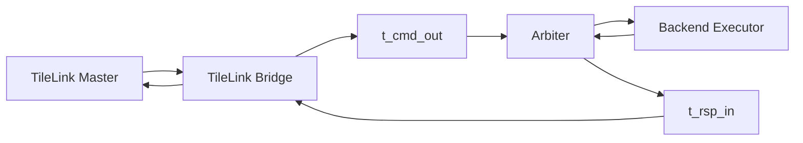
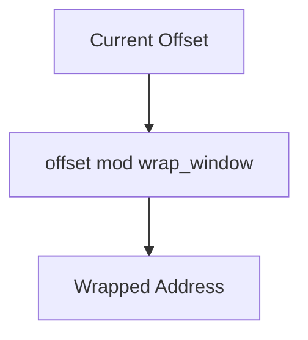

# DexterLab TileLink Bridge

The TileLink Bridge connects TileLink-based systems to the DexterLab command ecosystem.

It translates TileLink transactions into the DexterLab command interface (`t_cmd_out`) and converts DexterLab responses (`t_rsp_in`) back into TileLink responses.

This bridge enables TileLink masters, including RISC-V processors and subsystems, to access DexterLab backends through the same protocol-independent command model used throughout the framework.

---

# 1. Overview

TileLink is widely used as the native interconnect protocol within RISC-V systems.

Supported TileLink profiles include:

- TL-UL (TileLink Uncached Lightweight)
- TL-UH (TileLink Uncached Heavyweight)

DexterLab executes commands through a unified architecture:

```text
Parser / Master
        |
        v
     Arbiter
        |
        v
     Backend
        |
        v
       Bus
```

The TileLink Bridge acts as an adapter between the TileLink protocol and the DexterLab command infrastructure.

It performs:

```text
TileLink Request
        |
        v
     t_cmd_out
        |
        v
     Arbiter
        |
        v
     Backend
        |
        v
      t_rsp_in
        |
        v
TileLink Response
```

Backend selection remains entirely independent of TileLink.

---

# 2. Architecture Diagram



---

# 3. TileLink Scope

TileLink defines multiple communication channels.

The bridge supports only the channels required for uncached operation.

### Supported Channels

| Channel | Purpose |
|----------|----------|
| A | Requests |
| D | Responses |

### Unsupported Channels

The following coherent-system channels are not currently supported:

| Channel | Purpose |
|----------|----------|
| B | Probe |
| C | Release |
| E | Grant Acknowledge |

As a result:

```text
TL-C
```

is currently outside the scope of DexterLab.

---

# 4. Mapping TileLink to `t_cmd_out`

TileLink requests are translated into the protocol-independent DexterLab command interface.

## Field Mapping

| TileLink Field | DexterLab Field |
|----------------|-----------------|
| a.address | cmd_addr |
| a.source | cmd_id |
| a.data | cmd_data |
| a.mask | cmd_wstrb |
| a.size | cmd_size |
| a.opcode | cmd_write / command type |
| a.param | burst / wrap / lock attributes |

---

## Opcode Mapping

| TileLink Opcode | Meaning | DexterLab Mapping |
|-----------------|----------|-------------------|
| PutFullData | Full write | cmd_write = 1 |
| PutPartialData | Masked write | cmd_write = 1 + cmd_wstrb |
| Get | Read | cmd_write = 0 |
| ArithmeticData | Atomic operation | cmd_lock = 1 |
| LogicalData | Atomic operation | cmd_lock = 1 |
| Intent | Prefetch | Ignored |
| Acquire* | Cache-coherent operation | Not supported |

Atomic TileLink operations are translated into locked DexterLab commands.

Ownership protection is then enforced by the arbiter.

---

# 5. Mapping `t_rsp_in` to TileLink

Backend responses are translated into TileLink D-channel responses.

## Response Mapping

| DexterLab Field | TileLink Field |
|-----------------|----------------|
| rsp_data | d.data |
| rsp_id | d.source |
| rsp_last | d.last |
| rsp_err_code | d.error |
| rsp_end_cmd | Transaction complete |

---

# 6. Error Handling

TileLink provides a single error indication bit.

The complete DexterLab runtime error model is therefore compressed into:

```text
d.error = 0
```

Success.

```text
d.error = 1
```

Failure.

Examples:

```text
AXI_FULL SLVERR
AXI_FULL DECERR
AXI_FULL TIMEOUT
AHB_FULL ERROR
AHB_LITE BOUNDARY_ERR
AHB_LITE BURST_ERR
```

all become:

```text
d.error = 1
```

The detailed backend error classification remains available internally through:

```text
rsp_err_code
rsp_err_addr
rsp_err_beat
rsp_err_id
```

See:

```text
cmd_errors.md
```

for the complete DexterLab error database.

---

# 7. Burst Semantics

TL-UH supports multi-beat transfers.

These map directly to:

```text
cmd_burst
cmd_len
```

within `t_cmd_out`.

Examples:

| TileLink | DexterLab |
|-----------|-----------|
| Single beat | cmd_len = 1 |
| Multi-beat | cmd_burst = 1 |
| Burst sequence | cmd_len > 1 |

Maximum supported burst length follows backend limits.

---

# 8. Wrap Semantics

TL-UH wrapping operations map to:

```text
cmd_wrap = 1
```

Address generation is then performed by the selected backend.

Conceptually:



Supported wrap behavior is therefore backend-independent.

---

# 9. Atomic Operations

TileLink supports atomic transaction classes through:

- ArithmeticData
- LogicalData

These operations are translated into locked commands.

```text
cmd_lock = 1
```

The arbiter guarantees ownership retention during execution.

Atomicity is enforced by the DexterLab arbitration layer rather than by the backend itself.

---

# 10. Common Execution Model

The TileLink Bridge follows the standard DexterLab execution architecture.

```text
Phase 1
--------
Command execution

Phase 2
--------
Response publication

Phase 3
--------
Parser ready
```

This behavior is shared by:

- AXI-FULL
- AXI-LITE
- AHB-FULL
- AHB-LITE
- Generic Backend

The TileLink Bridge simply converts requests and responses while preserving this common execution model.

---

# 11. Bridge FSM

A typical bridge implementation follows the sequence:

```mermaid
stateDiagram-v2

    [*] --> TL_RECV

    TL_RECV*--> CMD_BUILD : a_valid

    CMD_B*ILD*--> CMD_SEND : command ready

    *MD_SEND*--> WAIT_RSP

    WAIT_RSP --> TL_*END : response received

    TL_SE*D --> TL_RECV
*``

---

# 12. Backend Selection

*he TileLink Bridge is completely i*dependent of the target backend.

*he bridge only generates*

```text
t_cmd_out
```

*nd consumes:

```text
t_rsp_in
*``

Supported backend targets*include:

- AXI-FULL
- AX*-LITE
- AHB-FULL
* AHB-LITE
- Generic Backend*
Backend selection is performed by*the system configuration*and not by the bridge itself*

---

# 13. Design Goals*
The bridge is designed to provide*

* TileLink compatibility
- R*SC-V integration
- Protocol-indepe*dent execution*- Backend reuse*- Unified error handling
- Unified*arbitration support*
No*TileLink-specific knowledge*is required inside individual*backends.

---

# 14. Summary

*he DexterLab TileLink Bridge:

- C*nnect* TileLink systems to the DexterLab*ecosystem
- Converts TileLink requ*sts into `*_cmd_out`
- Converts `*_rsp_in` into TileLink responses
-*Supports TL-UL and TL-UH
-*Supports bursts and wrap semantics*- Translates atomic*operations into arb*ter-controlled locked commands
- U*es the common Dexter*ab execution model
- Oper*tes with AXI-FULL, AXI-LITE, AHB-F*LL, AHB-LITE and Generic backends
*The bridge provides the foundation*for integrating DexterLab into mod*rn RISC-V platforms while preservi*g a unified command architecture.
*---

# End of Document
